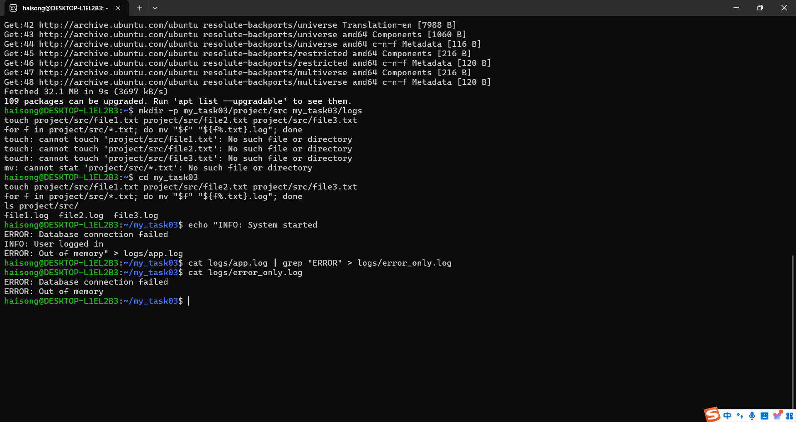
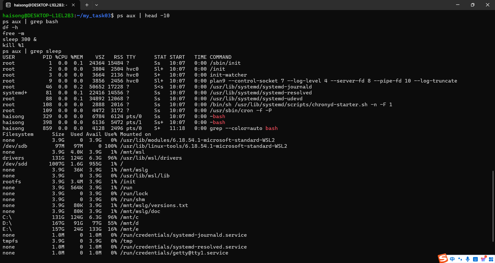
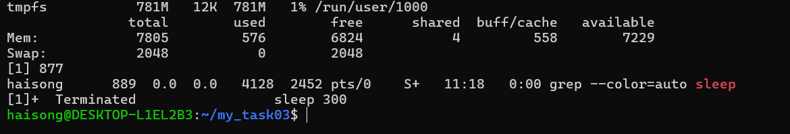
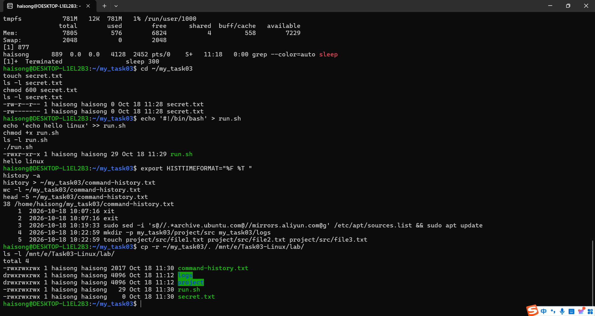

# Task 03 · Linux 终端基础与常用命令行实战

> **环境**：WSL2 + Ubuntu（Windows 11 26100）
> **登录用户**：`haisong`
> **工作目录**：`~/my_task03`
> **完成日期**：2026-10-18

---

## 一、任务目标与验收对照

本任务的目标是摆脱图形界面依赖，在 Linux 字符界面下独立完成文件管理、文本过滤、进程排查与权限设置。

| 交付要求 | 本仓库对应内容 | 状态 |
| :--- | :--- | :---: |
| 创建指定目录树 | [2.1 创建目录树](#21-创建目录树) | ✅ |
| 批量重命名文件 | [2.2 批量重命名](#22-批量重命名) | ✅ |
| 过滤指定日志文本并输出为新文件 | [2.3 日志过滤与输出](#23-日志过滤并输出为新文件) | ✅ |
| 执行历史（history） | [三、执行历史](#三执行历史) | ✅ |
| 操作截图 | [四、操作截图](#四操作截图) | ✅ |

---

## 二、操作序列

### 2.1 创建目录树

```bash
mkdir -p my_task03/project/src my_task03/logs
```

- `mkdir`：make directory，创建目录
- `-p`：parent，父目录不存在时自动逐级创建。**不加 `-p` 时只允许创建一层**，嵌套路径会直接报错
- 同时在一条命令里建 `project/src` 与 `logs` 两个分支

### 2.2 批量重命名

先用 `touch` 批量创建三个空文件：

```bash
cd my_task03
touch project/src/file1.txt project/src/file2.txt project/src/file3.txt
```

再用 `for` 循环配合 `mv` 批量把扩展名从 `.txt` 改成 `.log`：

```bash
for f in project/src/*.txt; do mv "$f" "${f%.txt}.log"; done
ls project/src/
```

输出结果：

```text
file1.log  file2.log  file3.log
```

**关键语法说明：**

| 片段 | 含义 |
| :--- | :--- |
| `for f in project/src/*.txt` | 通配符匹配所有 `.txt` 文件，逐个赋给变量 `f` |
| `"$f"` | 变量加双引号，防止文件名含空格时被拆成多个参数 |
| `${f%.txt}` | **从右往左**删掉最短匹配的 `.txt` 后缀，得到 `file1` |
| `${f#...}` | 与之相对的**从左往右**删前缀，例如 `${f#project/src/}` 得到纯文件名 |
| `mv A B` | 目标不存在时为「重命名」，目标存在时为「移动到目标内」 |

### 2.3 日志过滤并输出为新文件

用 `echo` 配合重定向生成一份含错误行的日志：

```bash
echo "INFO: System started
ERROR: Database connection failed
INFO: User logged in
ERROR: Out of memory" > logs/app.log
```

用 `grep` 过滤出含 `ERROR` 的行，并通过 `>` 写入新文件：

```bash
cat logs/app.log | grep "ERROR" > logs/error_only.log
cat logs/error_only.log
```

输出结果（共 2 行，4 行原始日志中被筛掉 2 行 INFO）：

```text
ERROR: Database connection failed
ERROR: Out of memory
```

| 符号 | 作用 | 风险提示 |
| :--- | :--- | :--- |
| `>` | 标准输出**覆盖**写入文件，文件原有内容被清空 | 用在日志上会丢数据 |
| `>>` | 标准输出**追加**到文件末尾 | 造日志、累计输出应使用它 |
| `\|` | 管道：把前一个命令的输出作为后一个命令的输入 | 无 |

> **优化写法**：`cat file | grep x` 可以省略 `cat`，直接 `grep "ERROR" logs/app.log > logs/error_only.log`，少启动一个进程，结果完全相同。

---

## 三、执行历史

> 由 `history` 命令导出（`HISTTIMEFORMAT="%F %T "` 开启时间戳，`history -a` 立即落盘），完整记录本次全部操作，共 38 条。

```text
    1  2026-10-18 10:07:16 xit
    2  2026-10-18 10:07:16 exit
    3  2026-10-18 10:19:33 sudo sed -i 's@//.*archive.ubuntu.com@//mirrors.aliyun.com@g' /etc/apt/sources.list && sudo apt update
    4  2026-10-18 10:22:59 mkdir -p my_task03/project/src my_task03/logs
    5  2026-10-18 10:22:59 touch project/src/file1.txt project/src/file2.txt project/src/file3.txt
    6  2026-10-18 10:22:59 for f in project/src/*.txt; do mv "$f" "${f%.txt}.log"; done
    7  2026-10-18 10:23:49 cd my_task03
    8  2026-10-18 10:23:49 touch project/src/file1.txt project/src/file2.txt project/src/file3.txt
    9  2026-10-18 10:23:49 for f in project/src/*.txt; do mv "$f" "${f%.txt}.log"; done
   10  2026-10-18 10:23:49 ls project/src/
   11  2026-10-18 10:24:25 echo "INFO: System started
ERROR: Database connection failed
INFO: User logged in
ERROR: Out of memory" > logs/app.log
   12  2026-10-18 10:24:59 cat logs/app.log | grep "ERROR" > logs/error_only.log
   13  2026-10-18 10:25:13 cat logs/error_only.log
   14  2026-10-18 11:15:10 history -a
   15  2026-10-18 11:15:10 ps aux / df -h / free -m / sleep 300 & + kill %1
   16  2026-10-18 11:18:56 ps aux | head -10
   17  2026-10-18 11:18:56 ps aux | grep bash
   18  2026-10-18 11:18:56 df -h
   19  2026-10-18 11:18:56 free -m
   20  2026-10-18 11:18:56 sleep 300 &
   21  2026-10-18 11:18:56 kill %1
   22  2026-10-18 11:18:56 ps aux | grep sleep
   23  2026-10-18 11:28:46 cd ~/my_task03
   24  2026-10-18 11:28:46 touch secret.txt
   25  2026-10-18 11:28:46 ls -l secret.txt
   26  2026-10-18 11:28:46 chmod 600 secret.txt
   27  2026-10-18 11:28:46 ls -l secret.txt
   28  2026-10-18 11:29:00 echo '#!/bin/bash' > run.sh
   29  2026-10-18 11:29:00 echo 'echo hello linux' >> run.sh
   30  2026-10-18 11:29:00 chmod +x run.sh
   31  2026-10-18 11:29:00 ls -l run.sh
   32  2026-10-18 11:29:00 ./run.sh
   33  2026-10-18 11:29:24 export HISTTIMEFORMAT="%F %T "
   34  2026-10-18 11:29:24 history -a
   35  2026-10-18 11:29:24 history > ~/my_task03/command-history.txt
```

---

## 四、操作截图

### 4.1 完整操作序列（建目录 → 批量改名 → 日志过滤）



画面依次包含：`apt` 换阿里云源并更新、`mkdir -p` 创建目录树、`touch` + `for` + `mv` 批量重命名、`echo` 多行重定向生成日志、`grep "ERROR" > error_only.log` 过滤输出、`cat` 验证结果。

### 4.2 进程查看与系统状态



画面包含：`ps aux | head -10` 进程列表、`ps aux | grep bash`、`df -h` 磁盘占用（可见 WSL2 根分区 `/dev/sdd`）、`free -m` 内存统计（Mem 总量 7805 MB）。

### 4.3 终止后台进程



画面包含：`sleep 300 &` 启动后台作业（作业号 `[1]`、进程号 877）、`ps aux | grep sleep` 确认存活、`kill %1` 终止后输出 `[1]+ Terminated sleep 300`、再次 `grep` 确认进程已消失。

### 4.4 文件权限与执行历史导出



画面包含：`chmod 600` 前后 `ls -l` 对比（`-rw-r--r--` → `-rw-------`）、`chmod +x` 后脚本权限变为 `-rwxr-xr-x`、`./run.sh` 成功输出 `hello linux`、`history` 导出 38 条带时间戳记录、`cp` 回传至 `/mnt/e/Task03-Linux/lab/` 后的 `ls -l` 确认。

---

## 五、踩坑记录

| 现象 | 根因 | 解法 |
| :--- | :--- | :--- |
| `touch: cannot touch 'project/src/file1.txt': No such file or directory` | 当前目录在 `~`，而目录建在 `~/my_task03/` 下，相对路径的**基点不对** | 先 `cd my_task03` 进入父目录，再执行同样的命令即成功；排错第一步永远是 `pwd` |
| `mv: cannot stat 'project/src/*.txt'` | 上一步 `touch` 全部失败，通配符 `*.txt` 没有匹配到任何文件 | 先确认前一步产物存在（`ls`），再执行依赖它的命令 |
| `ps aux / df -h ...` 报 `error: garbage option` | 把文档排版用的 `/` 误当成命令分隔符整行敲进了终端 | Shell 的多条命令分隔符是 `;`（顺序执行）或 `&&`（前一条成功才执行下一条）；最稳妥的做法是**一条命令占一行** |

**教训**：
1. Linux 的相对路径以「当前所在目录」为基准，而不是以「刚创建的位置」为基准。`pwd` 是最廉价的排错手段。
2. 报错 `garbage option` / `command not found` 时，先检查是不是把**非命令字符**（排版符号、中文标点）混进了命令行。

---

## 六、命令速查表

| 命令 | 作用 | 典型用法 |
| :--- | :--- | :--- |
| `pwd` | 显示当前所在目录 | `pwd` |
| `cd` | 切换目录 | `cd ~/my_task03` |
| `ls` | 列出目录内容 | `ls -l`（详情）、`ls -R`（递归）、`ls -a`（含隐藏） |
| `mkdir` | 创建目录 | `mkdir -p a/b/c` |
| `cp` | 复制 | `cp -r dir1 dir2` |
| `mv` | 移动 / 重命名 | `mv a.txt b.txt` |
| `rm` | 删除（**无回收站**） | `rm -r dir`；危险操作，慎用 `-f` |
| `cat` | 输出全文 | `cat app.log` |
| `head` / `tail` | 取头 / 尾 N 行 | `head -5 x.log`、`tail -f x.log` |
| `find` | 按条件查找文件 | `find . -name "*.log"` |
| `grep` | 按内容筛行 | `grep -c "ERROR" x.log`（计数）、`grep -i`（忽略大小写） |
| `wc` | 统计行/词/字节 | `wc -l x.log` |
| `ps aux` | 列出全部进程 | `ps aux \| grep bash` |
| `top` | 实时进程监控 | `top`，按 `q` 退出 |
| `kill` | 终止进程 | `kill %1`（作业号）、`kill -9 PID`（强制） |
| `df -h` | 磁盘空间 | `df -h` |
| `free -m` | 内存使用 | `free -m` |
| `chmod` | 改权限 | `chmod 600 secret.txt`、`chmod +x run.sh` |
| `chown` | 改属主 | `sudo chown $USER:$USER file` |

---

## 七、参考链接

- [GNU Coreutils 官方手册](https://www.gnu.org/software/coreutils/manual/coreutils.html)
- [Ubuntu 官方文档 · 命令行入门](https://help.ubuntu.com/community/UsingTheTerminal)
- [Linux 文件权限说明（chmod 数字含义）](https://www.gnu.org/software/coreutils/manual/html_node/File-permissions.html)

---

*文档由 WorkBuddy 协助整理，操作与截图由作者本人完成。*
