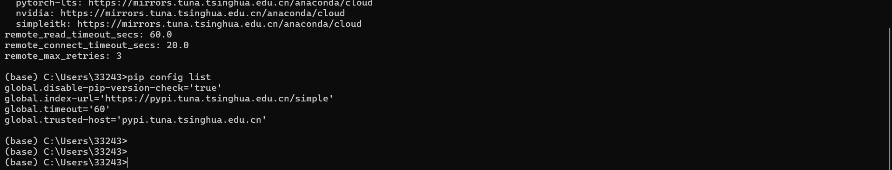
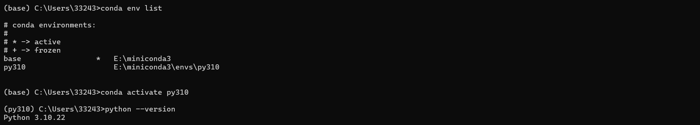
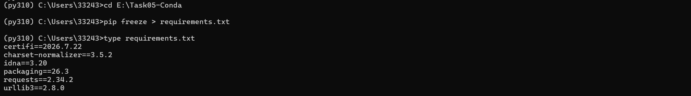

# Task 05 · Conda 虚拟环境隔离与镜像源加速配置

> **系统**：Windows 11 (26100)
> **安装位置**：`E:\miniconda3`（安装在 E 盘，因 C 盘仅剩 6.4 GB）
> **Conda 版本**：conda 26.9.3（Miniconda3 py314_26.9.3-0）
> **完成日期**：2026-10-18

---

## 一、任务要求与完成情况

| 任务步骤 | 完成情况 |
| :--- | :--- |
| 安装 Miniconda | ✅ 静默安装至 `E:\miniconda3`，未修改系统 PATH、未关联系统 Python |
| 配置国内镜像源（conda + pip） | ✅ 清华 TUNA，conda 与 pip 双通道 |
| 掌握核心环境管理命令 | ✅ create / activate / deactivate / env list / remove 全部实操 |
| 依赖导出与复现 | ✅ `pip freeze > requirements.txt` 与 `pip install -r` 双向验证 |

---

## 二、镜像源配置

### 2.1 conda 渠道配置（`C:\Users\33243\.condarc`）

```yaml
channels:
  - defaults
show_channel_urls: true
default_channels:
  - https://mirrors.tuna.tsinghua.edu.cn/anaconda/pkgs/main
  - https://mirrors.tuna.tsinghua.edu.cn/anaconda/pkgs/r
  - https://mirrors.tuna.tsinghua.edu.cn/anaconda/pkgs/msys2
custom_channels:
  conda-forge: https://mirrors.tuna.tsinghua.edu.cn/anaconda/cloud
  pytorch: https://mirrors.tuna.tsinghua.edu.cn/anaconda/cloud
  pytorch-lts: https://mirrors.tuna.tsinghua.edu.cn/anaconda/cloud
  nvidia: https://mirrors.tuna.tsinghua.edu.cn/anaconda/cloud
  simpleitk: https://mirrors.tuna.tsinghua.edu.cn/anaconda/cloud
remote_read_timeout_secs: 60.0
remote_connect_timeout_secs: 20.0
remote_max_retries: 3
```

**关键点**：
- `default_channels` 把官方的 `repo.anaconda.com` 全部替换为清华镜像 —— 官方源在国内实测**直接超时**（TCP 连接 18 秒无响应），必须换
- `custom_channels` 让 `conda install -c pytorch` 这类写法也走镜像
- `show_channel_urls: true` 让安装时打印真实下载地址，便于确认走的是镜像

### 2.2 pip 源配置（`C:\Users\33243\AppData\Roaming\pip\pip.ini`）

```ini
[global]
index-url = https://pypi.tuna.tsinghua.edu.cn/simple
trusted-host = pypi.tuna.tsinghua.edu.cn
timeout = 60
disable-pip-version-check = true
```

### 2.3 实测响应速度（绕开代理直连）

| 源 | 状态 | 响应时间 |
| :--- | :--- | :--- |
| 清华 TUNA（PyPI） | HTTP 200 | **0.39 s** |
| 腾讯云 PyPI | HTTP 200 | 1.19 s |
| 阿里云 PyPI | HTTP 200 | 0.28 s |
| repo.anaconda.com（官方 conda 源） | 超时 | > 18 s 无响应 |

---

## 三、环境创建与验证

### 3.1 创建指定 Python 版本的独立环境

```bash
conda create -n py310 python=3.10 -y
```

### 3.2 环境列表

```bash
$ conda env list

# conda environments:
#
base                     E:\miniconda3
py310                    E:\miniconda3\envs\py310
```

### 3.3 验证版本隔离

```bash
$ conda activate py310
(py310) $ python --version
Python 3.10.22
```

> 系统原有 Python 为 3.13.14 与 3.8.10，新环境为 3.10.22，三者互不干扰 —— 这就是"环境隔离"的意义。

---

## 四、依赖导出与复现

### 4.1 导出

```bash
(py310) $ pip install requests
Successfully installed certifi-2026.7.22 charset_normalizer-3.5.2 idna-3.20 requests-2.34.2 urllib3-2.8.0

(py310) $ pip freeze > requirements.txt
```

`requirements.txt` 内容：

```text
certifi==2026.7.22
charset-normalizer==3.5.2
idna==3.20
packaging==26.3
requests==2.34.2
urllib3==2.8.0
```

### 4.2 复现

```bash
pip install -r requirements.txt
```

输出（全部已满足，说明清单与环境完全一致）：

```text
Requirement already satisfied: certifi==2026.7.22 ...
Requirement already satisfied: requests==2.34.2 ...
Requirement already satisfied: urllib3==2.8.0 ...
```

---

## 五、踩坑记录

| 现象 | 根因 | 解法 |
| :--- | :--- | :--- |
| `curl` 访问所有镜像源均 20 s 超时（HTTP 000） | 当前 shell 继承了上游注入的 `HTTP_PROXY=127.0.0.1:62680`，该代理不可达 | 命令前加 `env -u HTTP_PROXY -u HTTPS_PROXY -u http_proxy -u https_proxy`，或用 `--noproxy '*'` |
| `repo.anaconda.com` 恒超时 | 官方源在国内网络不可达 | 改用清华 TUNA 镜像（`default_channels` 全部覆盖） |
| `conda activate` 报 `command not found` | conda 未接入 shell | 执行 `conda init powershell`，或直接用开始菜单的 **Anaconda Prompt (miniconda3)** |
| pip 装包后提示 `script xxx.exe is not on PATH` | 使用绝对路径调用 python，环境的 Scripts 目录未进 PATH | 无害告警；正确做法是 `conda activate` 后再用 `pip` |
| 安装位置不放 C 盘 | C 盘仅剩 6.4 GB，Miniconda 装完占 2 GB | 用 `/D=E:\miniconda3` 指定盘符，静默安装参数见下 |

### 静默安装命令（本次实际使用）

```powershell
Start-Process -FilePath "Miniconda3-latest-Windows-x86_64.exe" `
  -ArgumentList "/InstallationType=JustMe","/RegisterPython=0","/S","/D=E:\miniconda3" -Wait
```

- `/InstallationType=JustMe`：只给当前用户装，不需要管理员
- `/RegisterPython=0`：不把 conda 的 Python 注册为系统默认解释器，避免影响已有环境
- `/S`：静默，无向导
- `/D=`：安装目录，**必须是最后一个参数且路径不加引号**

---

## 六、日常使用流程

```bash
# 1. 打开 Anaconda Prompt (miniconda3)
# 2. 激活环境
conda activate py310

# 3. 干活
python your_script.py

# 4. 装了新包后更新依赖清单
pip freeze > requirements.txt

# 5. 退出
conda deactivate
```

### 常用命令速查

| 命令 | 作用 |
| :--- | :--- |
| `conda create -n 名字 python=3.10` | 新建指定 Python 版本的环境 |
| `conda activate 名字` | 进入环境 |
| `conda deactivate` | 退出环境 |
| `conda env list` | 列出所有环境 |
| `conda list` | 列出当前环境已装包 |
| `conda remove -n 名字 --all -y` | **彻底删除**环境（含所有包） |
| `conda clean -a -y` | 清理下载缓存（能腾出几百 MB） |
| `pip freeze > requirements.txt` | 导出依赖清单 |
| `pip install -r requirements.txt` | 按清单复现环境 |

> ⚠️ `conda remove -n 名字 --all` 会**连环境带包全部删除，不可恢复**。删之前先 `conda env list` 确认名字对不对。

---

## 七、操作截图

### 7.1 镜像源配置（conda + pip 双通道）



画面包含：`conda config --show-sources` 读取到的 `C:\Users\33243\.condarc`，其中 `default_channels` 与 `custom_channels` 全部指向 `mirrors.tuna.tsinghua.edu.cn`；以及 `pip config list` 输出的 `index-url = https://pypi.tuna.tsinghua.edu.cn/simple`。说明 conda 与 pip 两套包管理器的下载通道均已切换为国内镜像。

### 7.2 创建指定 Python 版本的独立环境



画面包含：`conda env list` 显示 `base` 与 `py310` 两个环境及其磁盘路径；执行 `conda activate py310` 后提示符由 `(base)` 变为 `(py310)`；`python --version` 输出 `Python 3.10.22`。与系统原有的 3.13.14、3.8.10 互不干扰，验证了环境隔离有效。

### 7.3 依赖导出



画面包含：在 `(py310)` 环境下执行 `pip freeze > requirements.txt`，并用 `type` 输出文件内容，共 6 个包（`certifi` / `charset-normalizer` / `idna` / `packaging` / `requests` / `urllib3`），均带精确版本号，可用于跨机器复现。

> **截图踩坑说明**：在 cmd 中执行 `cd E:\Task05-Conda` 不会切换盘符，导致首次导出的 `requirements.txt` 落在 `C:\Users\33243\` 下。正确写法是 `cd /d E:\Task05-Conda`（`/d` 才能跨盘符）。已确认两份文件内容一致，正式交付以 `E:\Task05-Conda\requirements.txt` 为准。

---

## 八、参考链接

- [Miniconda 官方文档](https://docs.conda.io/projects/conda/en/latest/index.html)
- [清华 TUNA 镜像使用帮助 · Anaconda](https://mirrors.tuna.tsinghua.edu.cn/help/anaconda/)
- [清华 TUNA 镜像使用帮助 · PyPI](https://mirrors.tuna.tsinghua.edu.cn/help/pypi/)
