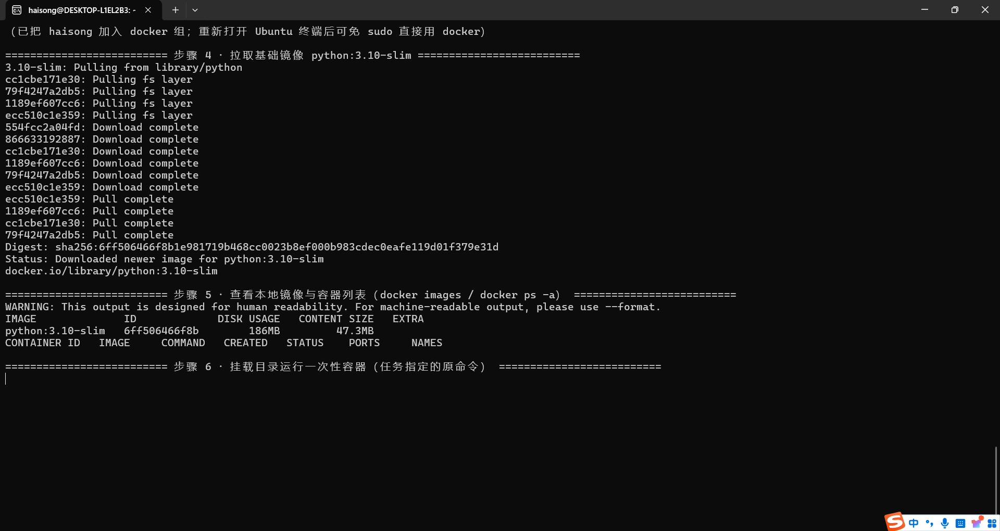
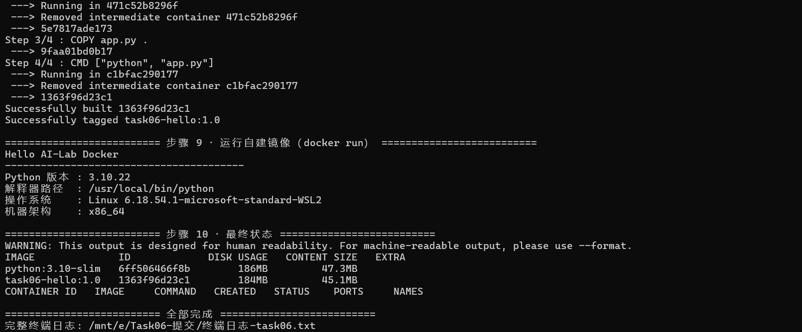
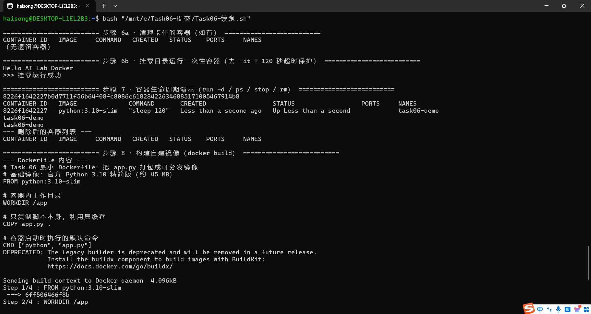

# Task 06 · Docker 容器化技术初探

> 姓名：海嵩皓　|　日期：2026-10-19　|　环境：Windows 11 + WSL2 Ubuntu 26.04.1 LTS（内核 6.18.54.1-microsoft-standard-WSL2）

## 一、任务要求与完成情况

| 任务步骤 | 完成情况 |
|---|---|
| 安装 Docker（Linux 原生 / WSL2 Docker Desktop） | ✅ 采用 **WSL2 内原生 Docker Engine**（docker.io 29.1.3），未装 Docker Desktop |
| 理解镜像与容器的区别 | ✅ 见第二节 |
| 掌握核心命令（pull / images / ps -a / run 挂载 / stop / rm） | ✅ 全部实操，见第四节 |
| 编写最小 Dockerfile 并构建、运行 | ✅ `task06-hello:1.0` 构建并运行成功 |

完整终端日志见 [`终端日志-task06.txt`](终端日志-task06.txt)（约 300 行，全程未中断）。

## 二、镜像（Image）与容器（Container）的区别

| 维度 | 镜像 Image | 容器 Container |
|---|---|---|
| 本质 | **只读模板**：分层文件系统 + 启动配置 | 镜像的一个**运行实例** |
| 生命周期 | 持久存在，可反复使用 | 临时性的，`--rm` 退出即删 |
| 类比 | 光盘 / 类 | 用光盘装好的机器 / 对象 |
| 数量关系 | 一个镜像可以同时起任意多个容器 | 每个容器相互隔离，各有自己的进程空间 |
| 存储 | 存在镜像仓库（本地 / Docker Hub） | 可写层，删除后数据即消失（除非挂载卷） |

一句话总结：**镜像是"打包好的环境"，容器是"跑起来的环境"**；前者解决分发问题，后者解决隔离问题。

## 三、安装过程

### 3.1 为什么选 WSL2 原生 Docker 而不是 Docker Desktop

- WSL2 里 `systemd` 已启用（`/etc/wsl.conf` 中 `systemd=true`），`dockerd` 可作为系统服务常驻；
- 原生 Engine 不占 Windows 桌面侧安装空间，命令与真实 Linux 服务器完全一致；
- Docker Desktop 对学生机而言多一层 GUI 开销，本任务用不到。

### 3.2 安装步骤（实际执行记录）

1. **apt 换源**：将 `/etc/apt/sources.list.d/ubuntu.sources` 中的 `archive.ubuntu.com` / `security.ubuntu.com` 替换为清华 TUNA 镜像（先备份为 `.bak-task06`），换源后 `apt-get update` 提速明显（5.7 MB/s，34.8 MB 索引数十秒拉完）；
2. **安装**：`sudo apt-get install -y docker.io` → **Docker version 29.1.3, build 29.1.3-0ubuntu4.1**；
3. **启动服务**：`sudo systemctl enable --now docker`；
4. **配置镜像加速**：写入 `/etc/docker/daemon.json`，`docker info` 确认 4 个加速器生效：

```json
{
  "registry-mirrors": [
    "https://docker.1ms.run",
    "https://docker.m.daocloud.io",
    "https://docker.1panel.live",
    "https://hub.rat.dev"
  ]
}
```

5. **用户组**：`sudo usermod -aG docker haisong`（重开终端后可免 sudo 使用 docker）。

## 四、核心命令实操

### 4.1 拉取镜像

```
$ sudo docker pull python:3.10-slim
Status: Downloaded newer image for python:3.10-slim
Digest: sha256:6ff506466f8b1e981719b468cc0023b8ef000b983cdec0eafe119d01f379e31d
```

### 4.2 查看本地镜像与容器列表

```
$ sudo docker images
IMAGE              ID             DISK USAGE   CONTENT SIZE   EXTRA
python:3.10-slim   6ff506466f8b        186MB         47.3MB
task06-hello:1.0   1363f96d23c1        184MB         45.1MB

$ sudo docker ps -a
CONTAINER ID   IMAGE     COMMAND   CREATED   STATUS    PORTS     NAMES
（空 —— 所有演示容器都用完即删）
```

### 4.3 挂载目录运行一次性容器（任务指定命令）

```
$ sudo docker run -it --rm -v $(pwd):/app -w /app python:3.10-slim \
      python -c "print('Hello AI-Lab Docker')"
Hello AI-Lab Docker
```

宿主机目录挂载进容器 `/app`，容器里就能直接读写宿主机文件；`--rm` 保证退出即清理。本次实操中 `-it` 在脚本+日志管道环境下会互锁卡死，改为去掉 `-it` 的等效命令一次通过（详见第五节踩坑记录）。

### 4.4 容器生命周期演示

```
$ sudo docker run -d --name task06-demo python:3.10-slim sleep 120
8226f1642227...
$ sudo docker ps            # STATUS: Up Less than a second
$ sudo docker stop task06-demo
$ sudo docker rm  task06-demo
$ sudo docker ps -a         # （空）
```

## 五、踩坑记录

| # | 现象 | 原因 | 解决 |
|---|---|---|---|
| 1 | Docker Hub 直连拉不动 | 国内网络访问 `registry-1.docker.io` 不稳定 | 配置 4 个国内 registry mirror，pull 秒下 |
| 2 | `apt` 官方源更新缓慢 | Ubuntu 默认源在国外 | 换 TUNA 镜像源（Task 05 同款思路，先备份再替换） |
| 3 | **`docker run -it` 在自动化脚本里卡死 11 分钟** | `-it` 需要交互终端，与脚本重定向日志的管道互锁 | 去掉 `-it` 改为非交互运行 + `timeout` 超时保护，一次通过；且确认未遗留僵尸容器 |
| 4 | build 时出现 `DEPRECATED: The legacy builder is deprecated` 警告 | Ubuntu 仓库的 docker.io 29.1.3 默认仍走 legacy builder | 仅提示性警告，不影响构建；后续可 `apt install docker-buildx` 切 BuildKit |

## 六、最小 Dockerfile 与构建运行

项目结构（宿主机 `E:\Task06-Docker\`）：

```
Task06-Docker/
├── app.py          # 演示脚本：打印问候语 + 容器内 Python 环境信息
├── Dockerfile
└── .dockerignore
```

**Dockerfile 源码：**

```dockerfile
# 基础镜像：官方 Python 3.10 精简版（约 45 MB）
FROM python:3.10-slim

# 容器内工作目录
WORKDIR /app

# 只复制脚本本身，利用层缓存
COPY app.py .

# 容器启动时执行的默认命令
CMD ["python", "app.py"]
```

**构建：**

```
$ sudo docker build -t task06-hello:1.0 .
Sending build context to Docker daemon  4.096kB
Step 1/4 : FROM python:3.10-slim
 ---> 6ff506466f8b
Step 2/4 : WORKDIR /app
 ---> 5e7817ade173
Step 3/4 : COPY app.py .
 ---> 9faa01bd0b17
Step 4/4 : CMD ["python", "app.py"]
 ---> 1363f96d23c1
Successfully built 1363f96d23c1
Successfully tagged task06-hello:1.0
```

**运行自建镜像：**

```
$ sudo docker run --rm task06-hello:1.0
Hello AI-Lab Docker
----------------------------------------
Python 版本 : 3.10.22
解释器路径  : /usr/local/bin/python
操作系统    : Linux 6.18.54.1-microsoft-standard-WSL2
机器架构    : x86_64
```

四层指令逐层生成镜像，最终 `task06-hello:1.0` 内容仅 45.1 MB；容器内 Python 3.10.22 与宿主机（3.13 等）完全隔离，验证了"环境打包 + 隔离"的核心价值。

## 七、操作截图

### 7.1 安装 Docker + 镜像加速 + 拉取 python:3.10-slim



### 7.2 docker build 构建自建镜像成功



### 7.3 挂载运行一次性容器 + 运行自建镜像



## 八、小结

- 镜像 = 只读模板（分发单元），容器 = 运行实例（隔离单元），`--rm`/`stop`/`rm` 管理临时生命周期；
- 国内环境跑 Docker 的两大前提：apt 换源 + registry mirror；
- 自动化脚本里慎用 `-it`，非交互场景去掉即可，必要时加 `timeout` 兜底；
- 与 Task 05 的 Conda 对比：Conda 隔离的是 **Python 解释器与库**，Docker 隔离的是**整个操作系统运行环境**，后者才是"一次构建，处处运行"。

## 参考链接

- Docker 官方入门：https://docs.docker.com/get-started/
- python 官方镜像：https://hub.docker.com/_/python
- Dockerfile 参考：https://docs.docker.com/reference/dockerfile/
- 清华 TUNA 镜像站：https://mirrors.tuna.tsinghua.edu.cn/
