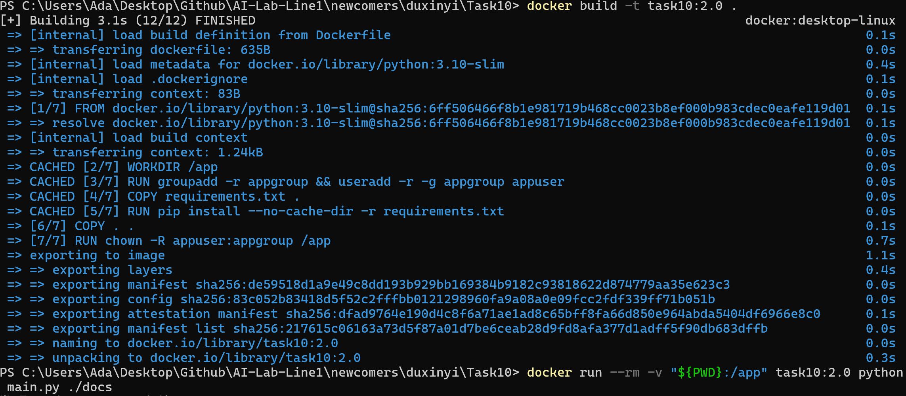
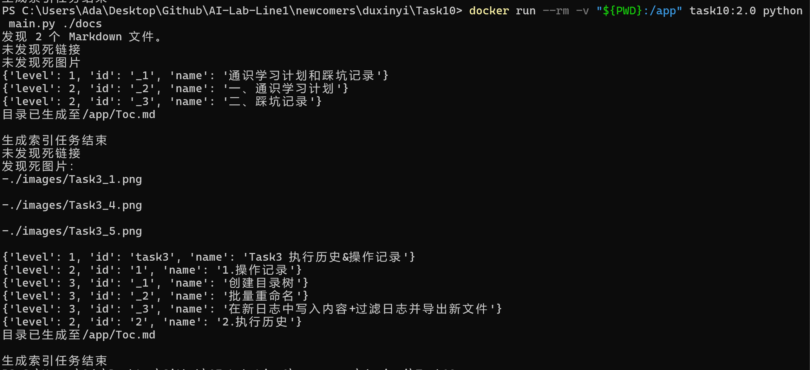
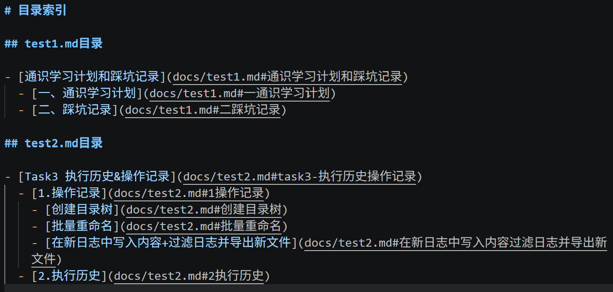

# 文档工程工具

## 项目介绍

1. 主要功能：扫描指定文件夹下的所有markdown文档，检测死链接和损坏图片，统计标题层级结构，生成良好的目录索引。
2. 组成：[main.py](./main.py)是项目入口，[check.py](./check.py)负责检测死链接和损坏图片，[analyze_headings](./analyze.headings.py)统计标题层级结构,[generate_toc](./generate_toc.py)成良好的目录索引
3. 输入参数与输出：命令行输入：扫描的文件夹相对于脚本的路径；目录索引默认以markdown格式，输出在main.py同级目录。

## 环境安装方法

1. 把四个代码文件、dockerfile、requirements.txt放到需要检测文件夹的根目录
2. 打开终端，用cd命令转到以上文件所在的位置
3. 启动docker，输入docker build -t <标签名>
4. 输入docker run --rm -v "${PWD}:/app" <标签名> python main.py <扫描文件夹相对于挂载路径的相对路径，如./docs> (linux中把{PWD}换成{pwd}即可)

## 运行示例

## 输出展示

### docker挂载本地目录下输出

测试时生成的目录索引，详见[目录索引](./Toc.md)
