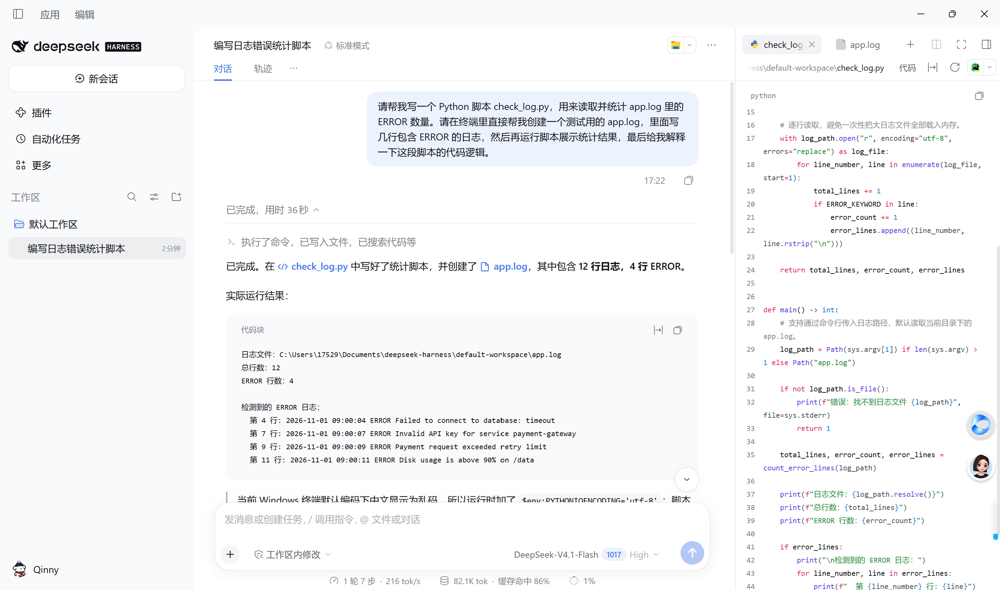

# AI-Lab 通识学习计划与环境踩坑记录

## 一、 学习计划
我计划在 **1个月内** 完成 AI-Lab 通识考核，核心节奏如下：
1. **第一周**：搞定开发工具链与基础环境（AI IDE、终端 Agent、API 接口、Linux、Git、Docker）。
2. **第二周**：巩固 Python 核心语法、文件 IO、异常处理，并完成至少 6 道洛谷算法题。
3. **第三周**：完成综合微项目（文档/日志处理 CLI 工具），争取提前分流进入后续业务线。

## 二、 核心环境配置说明
当前我使用的代码编辑工具为 Trae 和 VSCode，终端 AI 协同工具为 DSH，笔记工具为 Typora。以下是我常用工具的状态跟踪表：

| 工具名称 | 工具类型    | 核心功能/配置                     | 当前状态 |
| :------- | :---------- | :-------------------------------- | :------- |
| Trae     | AI 原生 IDE | 开启 Auto Mode，支持多模型切换    | ✅ 已配置 |
| VSCode   | 经典 IDE    | 配合插件通过中转站调用 Sonnet 4.6 | ✅ 已配置 |
| DSH      | 终端 Agent  | 内置 DeepSeek-V4.1-Flash 本地模型 | ✅ 已跑通 |
| Typora   | 笔记工具    | 所见即所得 Markdown 编辑器        | ✅ 已安装 |

## 三、 环境踩坑与排错记录 (Troubleshooting)
**问题描述**：在 Windows 原生 cmd 终端中，直接对 DSH 输入中文自然语言指令，导致系统报错。
**报错信息**：`'请帮我写一个' 不是内部或外部命令，也不是可运行的程序或批处理文件。`
**原因分析**：Windows 命令行只识别系统级指令（如 dir, cd），听不懂自然语言。必须启动 DSH 的专属 Web UI，在交互界面进行对话。
**解决方案**：使用 npx 运行 DSH 服务，在浏览器中进行交互。核心启动命令如下：

```bash
# 启动 DSH Web UI 服务
npx @deepseek-ai/dsh web
```

## 四、 环境配置截图
以下是我成功启动 DSH 并完成交互式代码审查的运行截图：



## 五、 外部参考链接
- 在排错与配置过程中，我重点参考了 DeepSeek 官方开源框架文档：
  [DeepSeek Harness 官方 GitHub 仓库](https://github.com/deepseek-ai/harness)