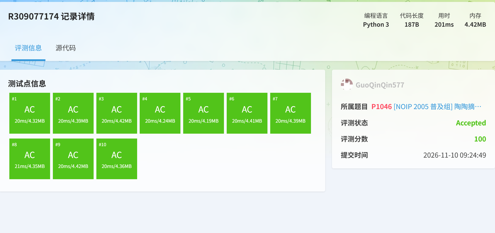
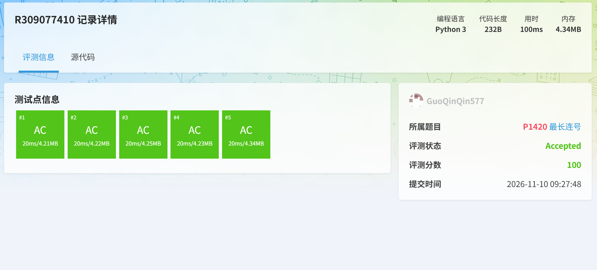
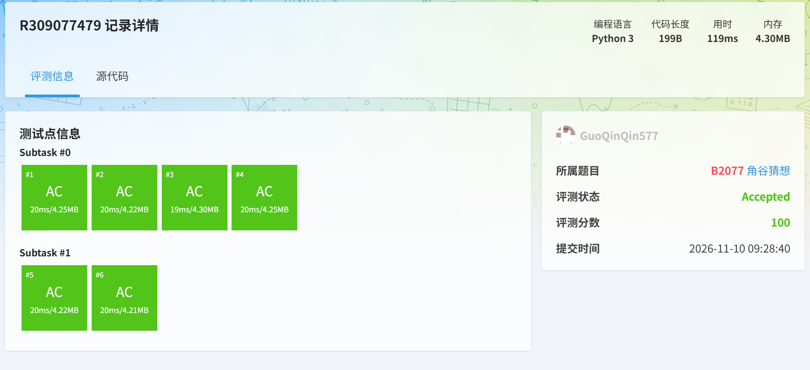
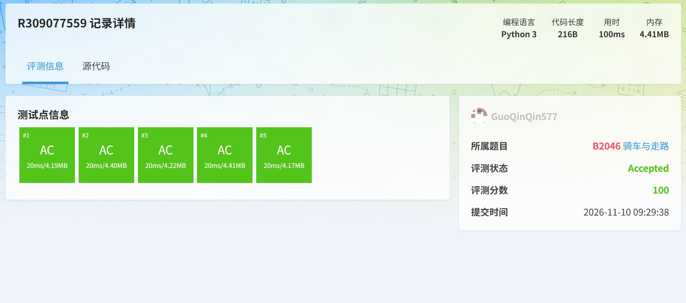
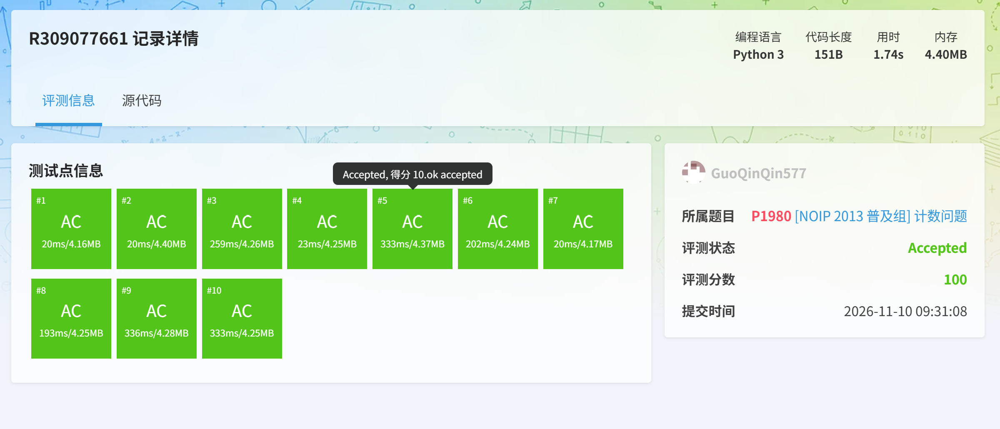
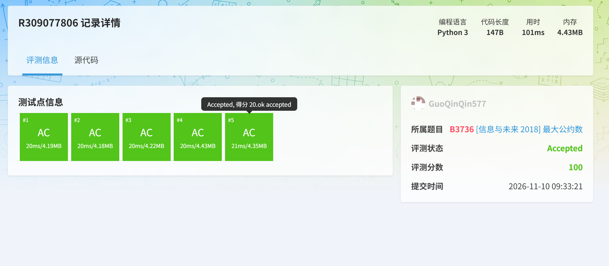
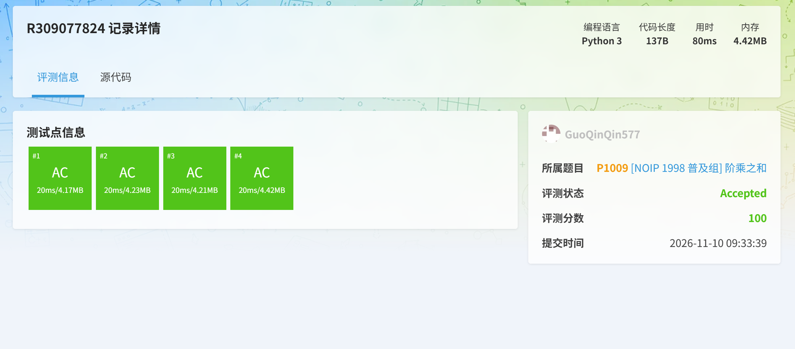

# Task 09 洛谷算法题通过记录

以下是我选做的全部题目及洛谷 Accepted 通过截图：

## 1. P1046 [NOIP2005 普及组] 陶陶摘苹果

## 2. P1420 最长连续自然数

## 3. B2077 角谷猜想

## 4. B2046 骑车与走路

## 5. P1980 [NOIP2013 普及组] 计数问题

## 6. B3736 [语言月赛 202305] 约数计数

## 7. P1009 [NOIP1998 普及组] 阶乘之和
