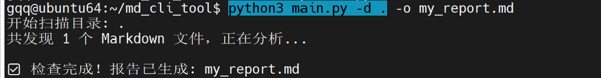
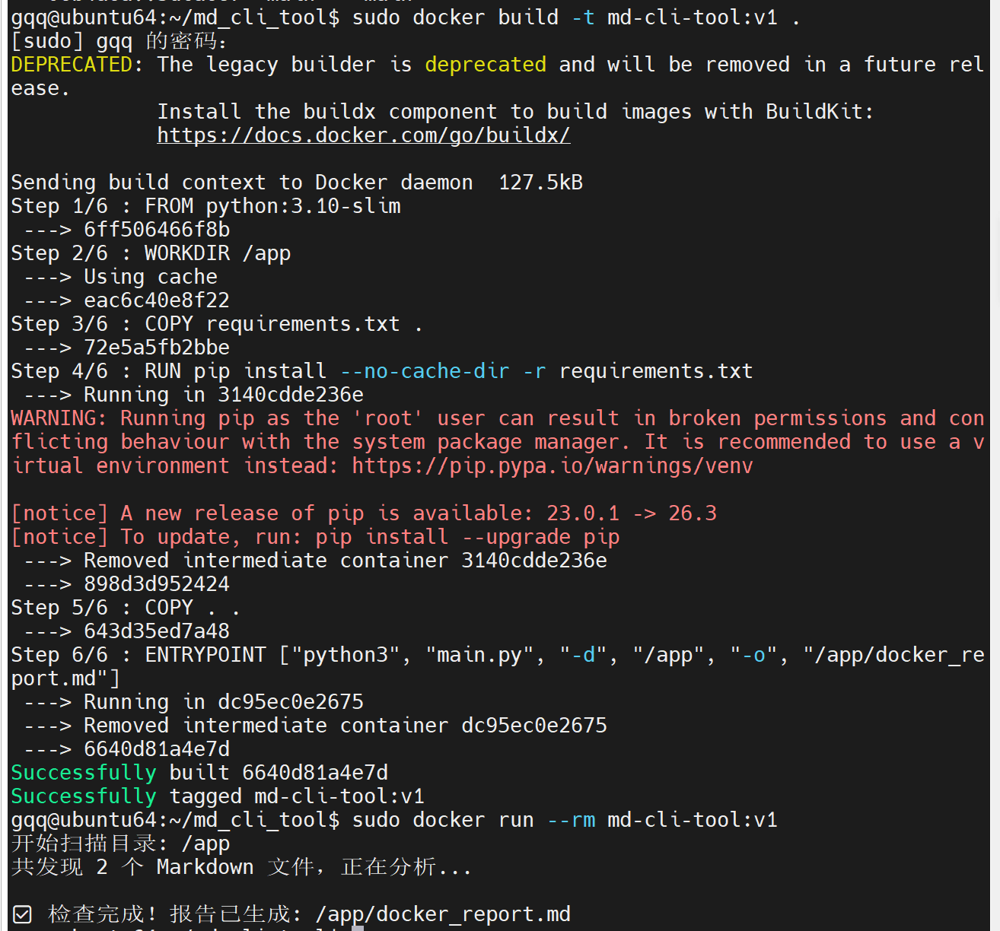

# Markdown 文档检查与清洗工具 (md-cli-tool)

## 📖 项目介绍
本项目是 AI-Lab 通识综合微项目（Task 10）。它是一款轻量级命令行工具（CLI），用于扫描指定目录下的 Markdown 文档，自动检测死链接与损坏图片，统计标题层级结构，并生成结构清晰的 Markdown 格式检查报告。

## 🛠️ 环境安装
### 方式一：本地 Python 直接运行
本项目仅依赖 Python 3 标准库，无需额外安装依赖。

```bash
git clone git@github.com:gqq070505/md_cli_tool.git
cd md_cli_tool
python3 main.py -d . -o report.md
```

### 方式二：Docker 容器化运行
确保已安装 Docker，执行以下命令构建并运行：

```bash
# 构建镜像
docker build -t md-cli-tool:v1 .

# 运行容器（自动在当前目录生成检查报告）
docker run --rm md-cli-tool:v1
```

## 🚀 运行示例与输出展示

```bash
# 扫描当前目录，并自定义输出报告名称为 report.md
python3 main.py -d . -o report.md
```

**本地运行截图：**


**Docker 容器化运行截图：**


## 📂 项目结构
- `main.py`：CLI 主入口与参数解析
- `src/`：模块化源码目录（包含扫描、检测、解析、报告生成）
- `Dockerfile`：容器化构建配置
- `requirements.txt`：依赖清单

---

## 💻 最终代码推送操作指南

编写并保存好 README.md 后，请在 Linux 终端执行以下命令，将代码和截图推送到 GitHub：

```bash
# 1. 将 README 和 docs 目录下的截图加入暂存区
git add README.md docs/

# 2. 提交更改
git commit -m "docs: 完善 README 文档，包含本地与 Docker 运行展示"

# 3. 推送到 GitHub 远程仓库
git push origin main
```
