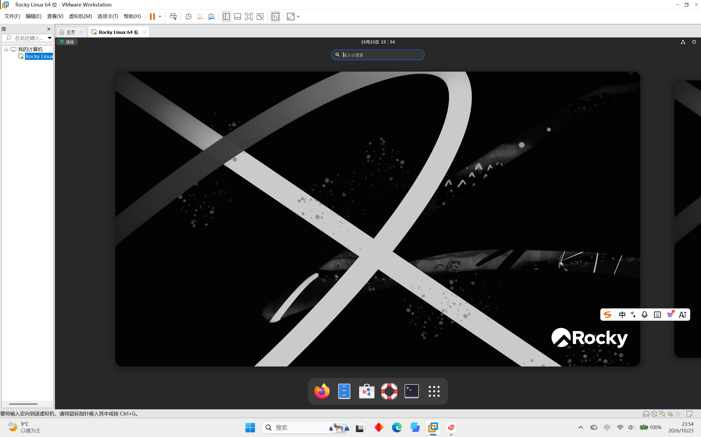
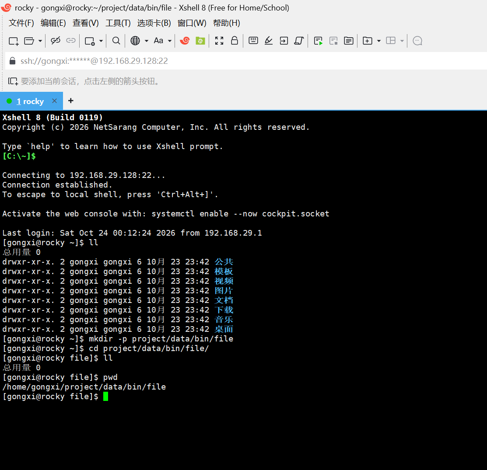
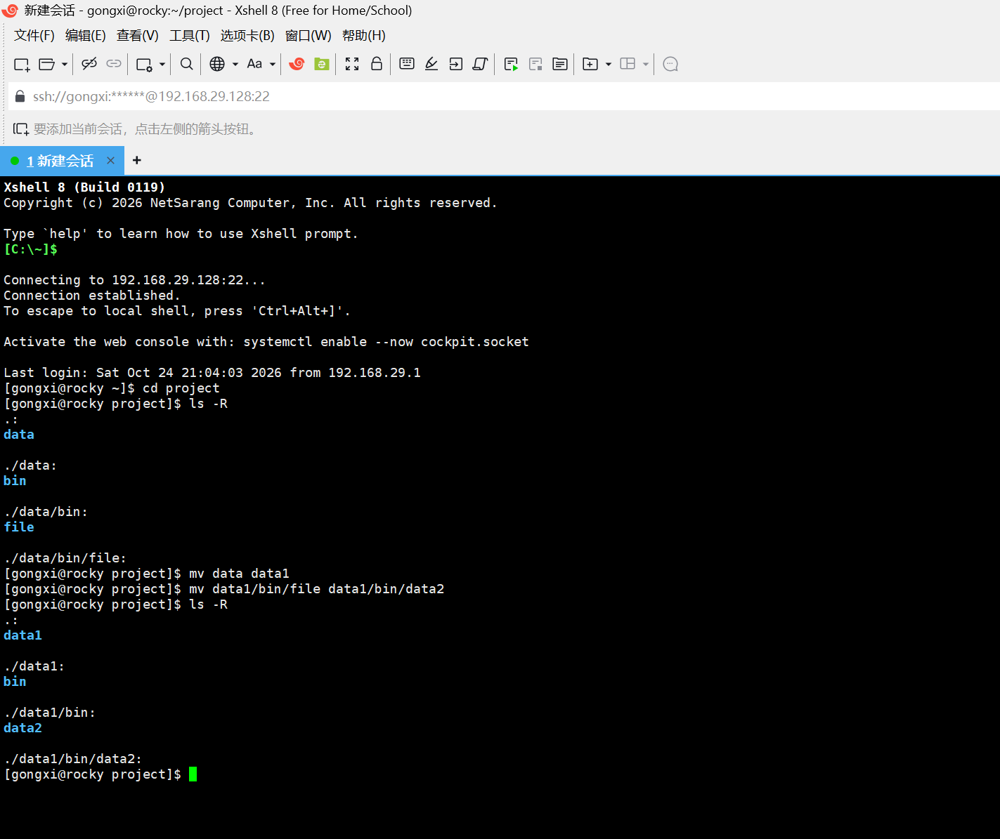
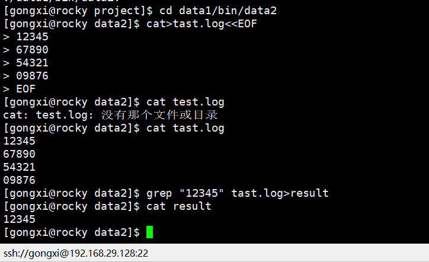
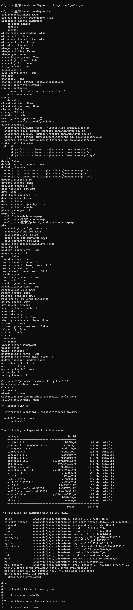

# AI-Lab 通识学习计划与环境踩坑记录

## 一、学习计划

按文档中的 Task 清单，1个月内完成所有任务。

### 目标

- 完成 Task 清单中的所有任务

### Task 清单（共 9 个）

#### Task 1：现代 AI 编程环境（Trae / VSCode）与 CLI 协同工具配置
- 安装 Trae / VSCode及CLI工具Opencode
- 完成标准：
  1.成功用Trae编写了一个简单的Python程序"hello"

  ```python
  print("hello ")
  ```
  2.成功用Opencode编写了从1到100累加整数和的Python程序
  ```python
  total = 0
  for i in range(1, 101):
    total += i
  print(total)
  ```
  还进行了一次交互，修改了代码，让用户自定义累加范围
  ```python
  n== int(input("请输入一个正整数："))
  total = 0
  for i in range(1, n+1):
    total += i
  print(total)
  ```

#### Task 2：Linux 终端基础与常用命令行实战
- 在VMware Workstation中安装Linux系统（Rocky Linux）
1. 熟练掌握目录与文件操作命令：pwd、cd、ls (或 eza)、mkdir、rm、cp、mv、cat、head、tail、find；
2. 熟练掌握文本过滤与管道操作：grep、wc、标准输入输出重定向（>、>>、|）；
3. 熟悉系统状态与进程排查：ps aux、top (或 btop)、kill、df -h、free -m；
4. 掌握文件权限基础：chmod、chown。
- 完成标准：









- 踩坑记录：[见「坑 1」](#坑-1关联-task-2)

#### Task 3：Git 版本管理规范与 GitHub 协作实操

- 设置VS Code为Git默认编辑器
- 完成标准：


- 踩坑记录：[见「坑 2」](#坑-2关联-task-3)

#### Task 4：Conda 虚拟环境隔离与镜像源加速配置
1.通过清华镜像网站快速安装Conda，并设置环境变量

2.清华镜像网站的使用帮助配置Conda源

3.创建虚拟环境
```
conda create -n PY python=3.10
```
4.激活环境
```
conda activate PY
```
退出环境
```
conda deactivate
```

5.安装包
```
conda install 包名
```

6.导出和复现
```
pip freeze > requirements.txt
pip install -r requirements.txt
```

- 完成标准:
  

  

  

#### Task 5：Docker 容器化技术初探
- 完成标准：

#### Task 6：Python 核心语法与常用数据结构

- 完成标准：

#### Task 7：Python 文件 I/O、异常处理与工程基础

- 完成标准：

#### Task 8：经典算法与编程逻辑专项巩固

- 完成标准：

#### Task 9：通识综合微项目实战

- 完成标准：

## 二、环境踩坑记录

### 坑 1（关联 Task 2）

#### 现象

B 站主流教学视频均采用 CentOS 7 演示，但该系统已停止维护，照教程操作无法获得可用、稳定的环境。

#### 原因

CentOS 7 已停止维护（EOL），原有镜像源逐步下线，教程中的安装与配源步骤已过期，直接照做会卡在镜像源不可用这一步。

#### 解决方法

与 AI 智能体反复交互，确认可用 Rocky Linux 替代 CentOS（同为 RHEL 系、命令基本一致）；再通过小红书等社区帖子找到可用的镜像网站，从而快速完成系统下载与配置。

### 坑 2（关联 Task 3）

#### 现象

1. 本机 Windows 用户名为中文，默认 C 盘用户目录出现路径乱码，密钥生成失败。
2. `ssh -T git@github.com` 报 `port 22: Connection refused`。
3. 密钥放在 D 盘后，直接 `git push` / `git pull` 提示 `Permission denied (publickey)`。
4. 单独执行 `ssh -F /d/git/ssh/config -T git@github.com` 认证成功，但直接 `git push` 失败。

#### 原因

1. Git Bash 对中文用户名的原生 OpenSSH 路径解析异常。
2. 网络封禁了 GitHub 的 22 SSH 端口。
3. SSH 默认只读取 `~/.ssh/` 下的配置，不会自动加载 D 盘的 `config` 和私钥。
4. Git 执行 push/pull 时不会自动带上 `-F` 指定的配置文件参数。

#### 解决方法

1. 将密钥存放至 D 盘，避开中文路径。
2. 改用 443 端口，连接 `ssh.github.com:443`。
3. 让 SSH 默认也读到 D 盘的配置：在 `~/.ssh/config` 顶部加一行 `Include D:/git/ssh/config`，使 `git push` / `pull` 走默认路径时也能加载 D 盘的 config 与私钥。
4. 让 Git 自动带上 `-F`：执行 `git config --global core.sshCommand "ssh -F /d/git/ssh/config"`，此后 git 执行远程操作时会自动使用该配置文件。
