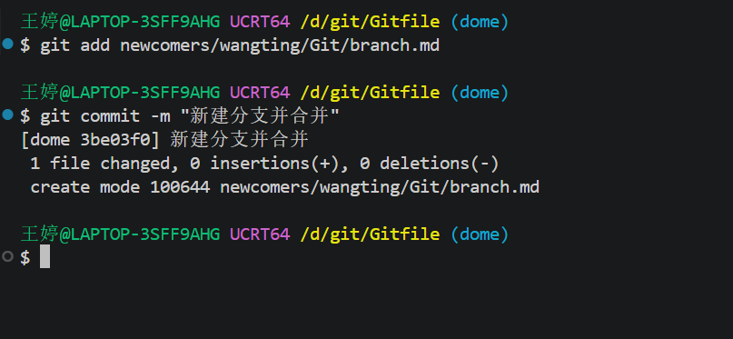

# Git分支合并
- 进行Git分支创建、切换、提交、合并操作；完成分支开发并合并，生成带有分叉的提交树。

 ## 一、分支规划
不合并到 main，从分支 `basic/wangting` 分出dome分支，开发完成后合并回 `basic/wangting`。
 ## 二、操作步骤
 ### 1. 初始状态确认
 操作前位于 `basic/wangting`
 ```
 git status
 ```
 输出：
 ```
 On branch basic/wangting
Your branch is up to date with 'origin/basic/wangting'.

nothing to commit, working tree clean
```
### 2.创建并切换到dome分支
```
git branch dome
```
```
git checkout dome
```
输出：
```
Switched to branch 'dome'
```
### 3.在dome分支里开发
- 在dome分支新建并编写本文档 branch.md，完成后提交

