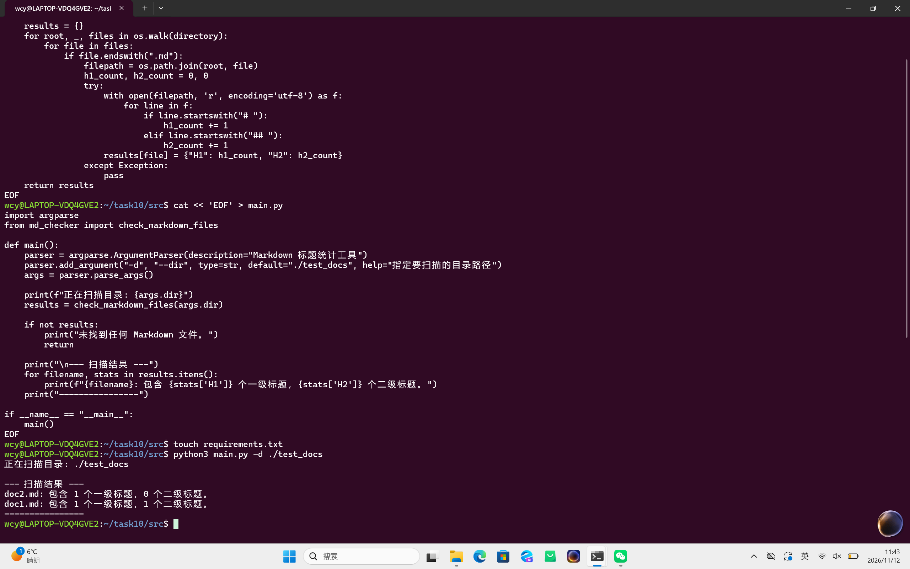
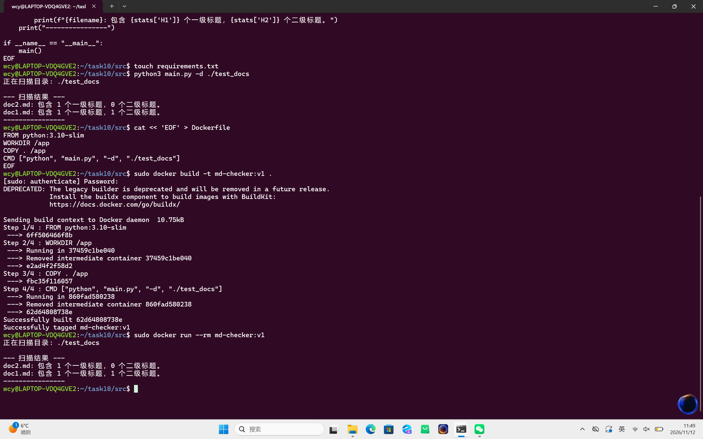

Task 10: 自动化文档/日志处理 CLI 工具

一、 项目简介
本项目使用 Python 编写了一个轻量级 CLI 工具，用于扫描指定目录下的 Markdown 文件，并统计每个文件的一级标题（#）和二级标题（##）的数量。

二、 核心代码
包含两个模块：
- `md_checker.py`：负责 Markdown 文件的遍历与标题统计逻辑。
- `main.py`：使用 `argparse` 提供命令行参数入口，支持通过 `-d` 指定扫描目录。

三、 容器化与运行
已编写 `Dockerfile`，并在本地成功完成构建与运行。
- 构建命令：`sudo docker build -t md-checker:v1 .`
- 运行命令：`sudo docker run --rm md-checker:v1`

四、 运行截图



五，报错说明


在完成这个综合项目的过程中，遇到了几个典型的环境与操作问题，经过排查均已解决：

1. 终端粘贴 Markdown 格式符报错
   现象：终端报错 `'```bash' 不是内部或外部命令`。
   原因：复制代码时，连带着 Markdown 的代码块标识符（三个反引号和 bash）一起复制进了终端。
   解决：只复制纯代码部分重新粘贴执行。

2. nano编辑器卡死（出现白色长条）
   现象：在 WSL 中使用 `nano` 编辑文件时，屏幕出现白色长条，无法输入也无法保存退出。
   解决：直接按 `Ctrl + C` 强行中断，或者关闭终端重开。为了彻底避开这个坑，后续改用 `cat << 'EOF' > 文件名` 的方式，直接在终端里用指令生成代码文件，极其稳定。

3. Python 运行报错 No such file or directory**
   现象：执行 `python3 main.py` 时，提示找不到文件。
   原因：通过 Windows 弹窗新建文件时，路径没有对齐，或者系统隐藏了后缀名，导致建成了 `main.py.txt`，根本没有放进当前的 Linux 目录里。
   解决：全盘推倒重来，使用 `rm -rf task10` 删掉错乱的目录，全程在 Linux 终端里用 `cat` 命令自动生成文件。

4. Docker Build 找不到文件或权限报错
   现象：在 `mnt/c/Users/wcy` 目录下执行 `docker build` 报错或卡住。
   原因：跨系统挂载目录（Windows C盘）下包含系统隐藏缓存文件，Docker 读取时权限不足。
   解决：执行 `cd ~/task10/src` 切回 Linux 原生家目录，在纯净的环境中重新构建。

5. Git 提交报错 Author identity unknown
   现象：`git commit` 时红字报错，提示不知道作者是谁。
   原因：新装的 Git 没有配置全局用户信息。
   解决：执行 `git config --global user.email "你的邮箱"` 和 `git config --global user.name "你的名字"` 完成身份认证后，重新提交成功。