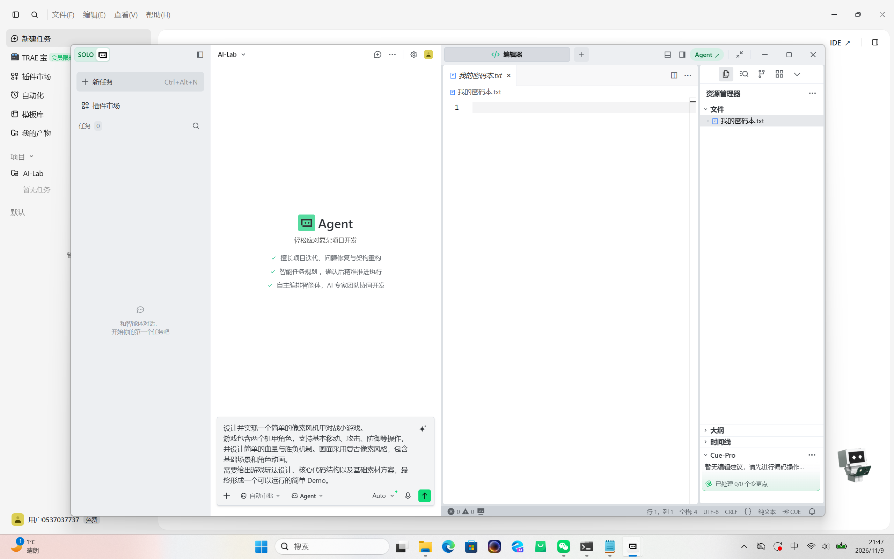

1.个人学习计划

    我的学习进度如下：
| 任务阶段 | 任务内容 | 状态 |
| :--- | :--- | :--- |
| Task 01 | 环境搭建 | 已完成 |
| Task 02 | 笔记系统 | 进行中 |

2.环境配置与踩坑记录
我电脑的系统环境比较特殊，Python 是极新版本导致依赖编译冲突，我选择了文档里备选的网页端交互方式，并已成功跑通并截图。

3.验证代码块语法
```python
def hello_world():
    print("Hello, AI-Lab!")
    return True

hello_world()
```

4. 环境截图与参考链接

以下是我配置的 AI IDE (TRAE) 工作界面截图：


外部参考链接：
- [硅基流动模型广场](https://siliconflow.cn/)

5.报错记录
1. 新建 .md 文件失败或变成了 .txt
   现象：输入文件名后系统提示无效，或文件图标不对。
   原因：Windows 默认隐藏已知文件扩展名，导致建成了 文件名.md.txt。
   解决：在文件夹“查看”菜单中勾选“文件扩展名”，手动重命名。
2. 本地图片无法在 Markdown 中显示
   现象：预览时只有文字和破损图标。
   原因：代码里的图片路径/名称与实际图片不符，或未放在同一目录。
   解决：确保图片和 .md 文件在同一文件夹，且代码  中的名字完全一致（包含大小写）。