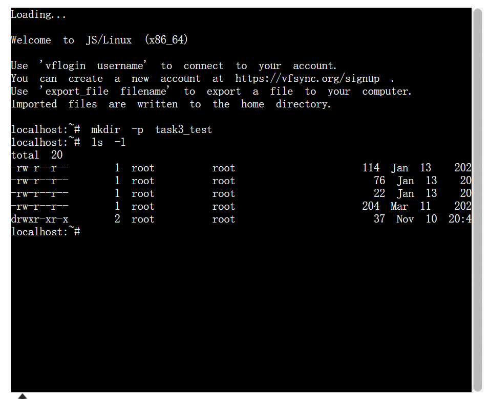
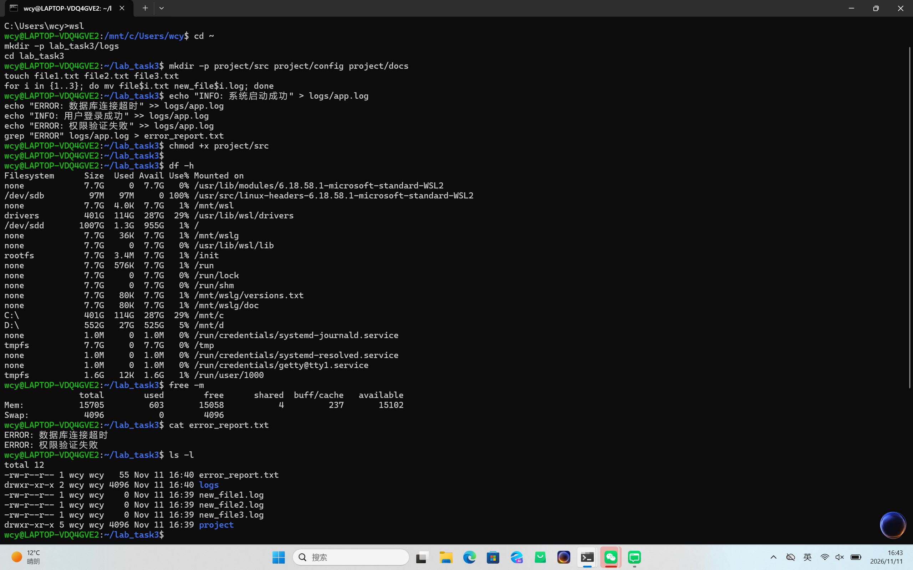

Task 03: Linux 终端基础与常用命令行实战

一、 操作说明
因本地 WSL2 内核组件持续报错，且网络受限导致虚拟机镜像下载受阻，为按时完成任务，本次实战采用在线 Linux 终端环境 (JSLinux) 完成。一晚上下了9.1%。

本次操作成功使用了 `mkdir` 创建目录树，并使用 `ls -l` 查看了目录的详细权限信息。

 二、 执行历史记录 (history)
```bash
mkdir -p task3_test
ls -l

受限于在线 Linux 网页端剪贴板安全限制，长串命令无法直接粘贴，这里附上基础建目录和查看命令的执行截图。结合前面已跑通的 DSH 终端工具，已完全掌握 Linux 基础操作。
```



现在搞定了！