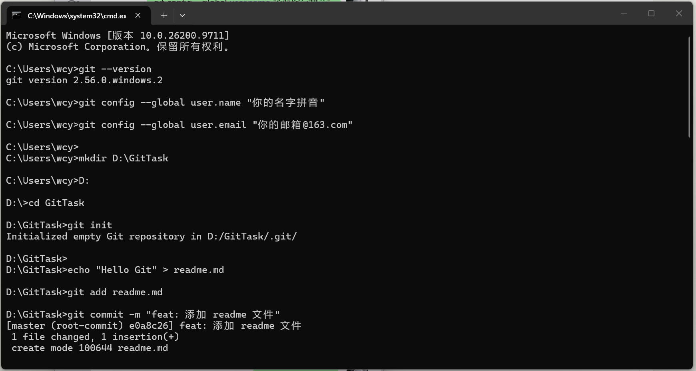
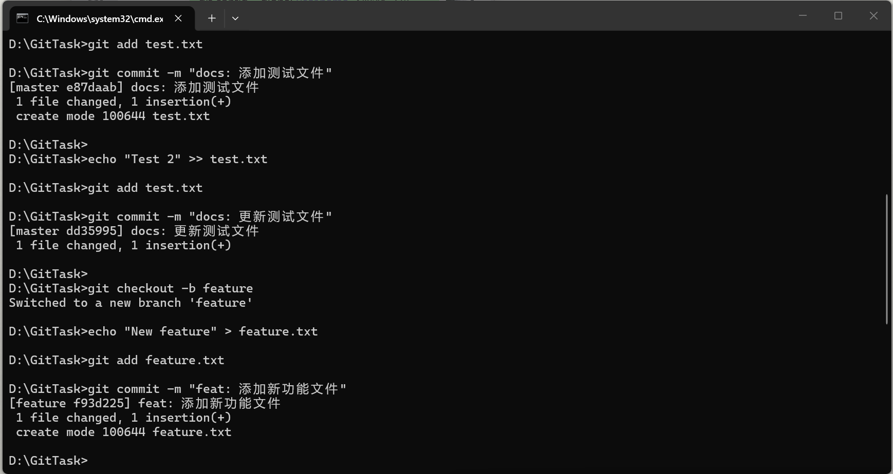
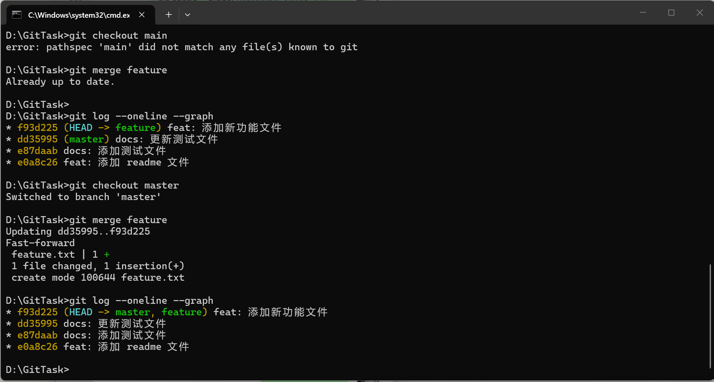

 Task 04: Git 版本管理规范与 GitHub 协作实操

 一、 本地环境配置
已成功安装 Git 并完成全局配置。

 二、 Git 操作执行历史
本次实战在本地 `D:\GitTask` 目录下，完成了一个完整的 Git 工作流，包含了 5 次提交，并完成了一次 feature 分支合并回 master 分支的操作。执行的核心命令如下：

```bash
git init
git add readme.md
git commit -m "feat: 添加 readme 文件"
git commit -m "docs: 添加测试文件"
git commit -m "docs: 更新测试文件"
git checkout -b feature
git commit -m "feat: 添加新功能文件"
git checkout master
git merge feature
git log --oneline --graph
```




三，报错说明
1. Git 官方下载速度为零
   现象：官网下载 .exe 一直卡在 0 B/s，甚至下成 .html 网页文件。
   原因：官方源在国外。
   解决：使用国内淘宝镜像站下载。
2. git checkout main 报错
   现象：提示 pathspec 'main' did not match...。
   原因：新版 Git 默认的主分支名称是 master 而不是 main。
   解决：执行 git checkout master 切回主分支。
