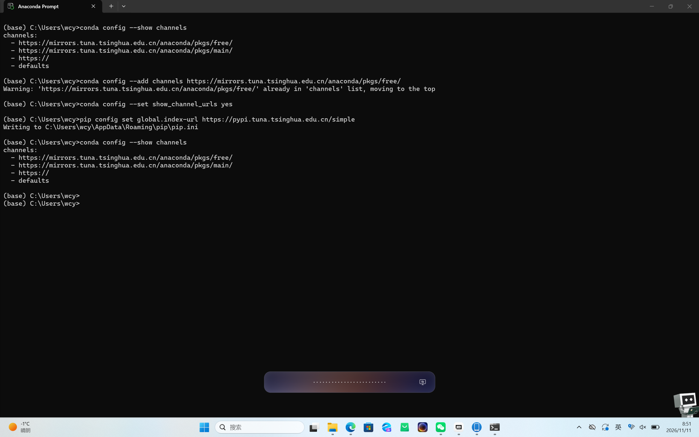
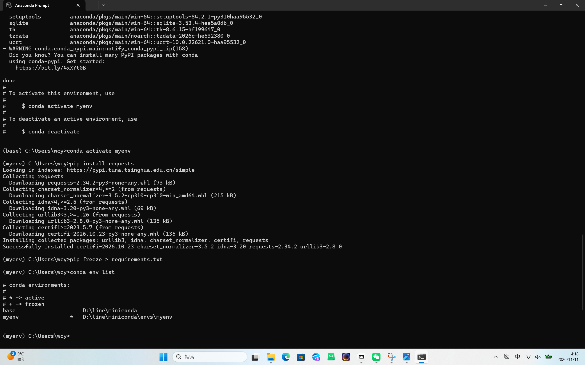

```markdown
# Task 05: Conda 虚拟环境隔离与镜像源加速配置

## 一、 镜像源配置与工具安装
已成功安装 Miniconda（为避免占用 C 盘，已将其安装在 D 盘目录 `D:\lang\miniconda3` 下）。
为了大幅提升后续下载包的速度，已成功配置清华大学镜像源：

```cmd
conda config --add channels https://mirrors.tuna.tsinghua.edu.cn/anaconda/pkgs/main/
conda config --add channels https://mirrors.tuna.tsinghua.edu.cn/anaconda/pkgs/free/
conda config --set show_channel_urls yes
pip config set global.index-url https://pypi.tuna.tsinghua.edu.cn/simple
```

二、 核心操作记录与排错实战（踩坑记录）

在创建独立环境的过程中，遇到了几个典型的网络与配置报错，经过排查最终成功解决，过程如下：

1. 遇到报错：网络连接超时与域名解析失败

· 报错现象：输入 conda create -n myenv python=3.10 后，终端不断输出 Retrying (Retry(total=2...))，并伴随 NameResolutionError 或 HTTP 000 CONNECTION FAILED。
· 原因分析：Conda 默认会去连接国外的官方源，由于网络限制导致超时。
· 解决办法：强制 Conda 绕过默认源，通过 -c 参数直接指定清华源进行下载。
· 执行命令：
  ```cmd
  conda create -n myenv python=3.10 -y --override-channels -c https://mirrors.tuna.tsinghua.edu.cn/anaconda/pkgs/main/
  ```

2. 遇到报错：Terms of Service 未同意

· 报错现象：提示 CondaToSNonInteractiveError: Terms of Service have not been accepted。
· 原因分析：新版 Conda 强制要求用户同意官方频道的服务条款。
· 解决办法：运行同意条款的命令解除锁定：
  ```cmd
  conda tos accept --override-channels --channel https://repo.anaconda.com/pkgs/main
  conda tos accept --override-channels --channel https://repo.anaconda.com/pkgs/r
  conda tos accept --override-channels --channel https://repo.anaconda.com/pkgs/msys2
  ```

3. 成功创建并激活环境

执行上述排查后，环境创建成功（终端提示 done）。成功激活环境：

```cmd
conda activate myenv
```

(激活后，命令提示符前缀从 (base) 变为了 (myenv))

三、 依赖导出与最终验证

1. 安装测试包：
   ```cmd
   pip install requests
   ```
   (得益于配置了国内源，下载和安装瞬间完成)
2. 导出依赖清单：
   ```cmd
   pip freeze > requirements.txt
   ```
   (该文件已随作业一并提交)
3. 查看本地所有环境：
   ```cmd
   conda env list
   ```
   (输出显示 base 和 myenv 两个环境，且均安全存放于 D 盘)

四、 截图证明




五，其他报错说明
1. 普通 CMD 找不到 Conda 命令
   现象：输入 conda activate 提示“不是内部或外部命令”。
   原因：在系统自带终端运行，未配置全局环境变量。
   解决：必须从开始菜单打开专用的 Anaconda Prompt 终端。
2. Conda 创建环境无限 Retry
   现象：疯狂刷 Retrying... 和 NameResolutionError。
   原因：官方源被墙，网络不通。
   解决：强制指定清华源 -c https://mirrors.tuna... 创建环境。
3. 未同意服务条款报错
   现象：CondaToSNonInteractiveError。
   原因：新版 Conda 的强制要求。
   解决：执行 conda tos accept... 命令同意条款。
4. 复制了 Markdown 格式代码
   现象：终端报错 '```cmd' 不是内部或外部命令。
   原因：把反引号连同代码一起复制进终端了。
   解决：只复制纯命令部分。
