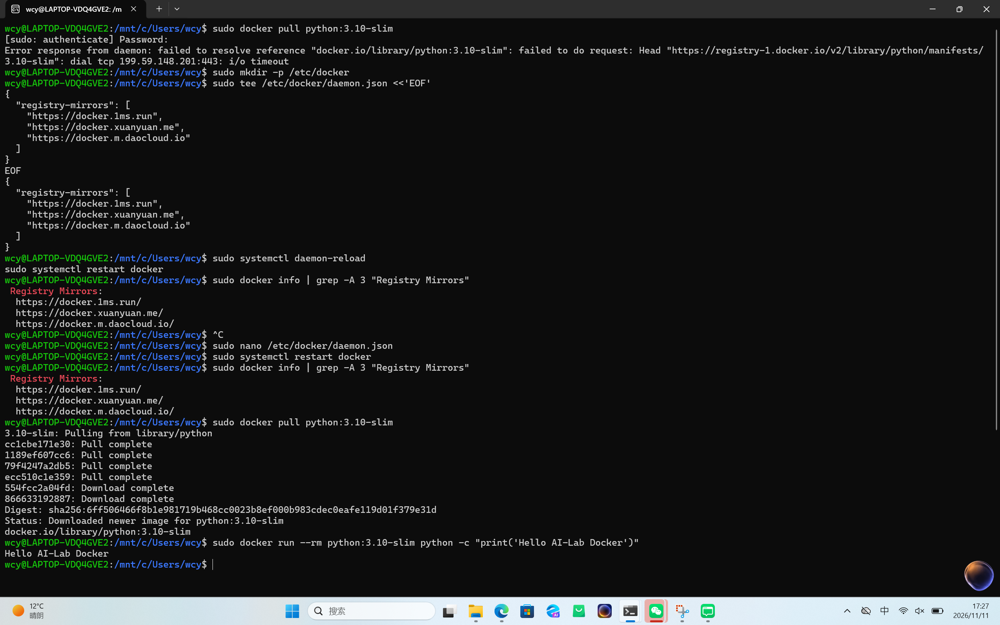
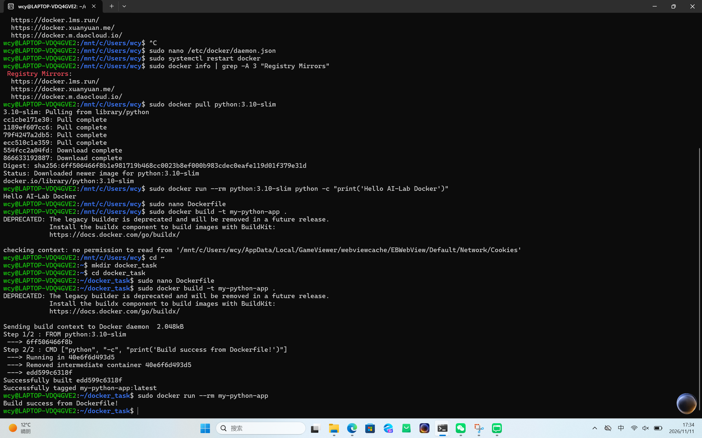
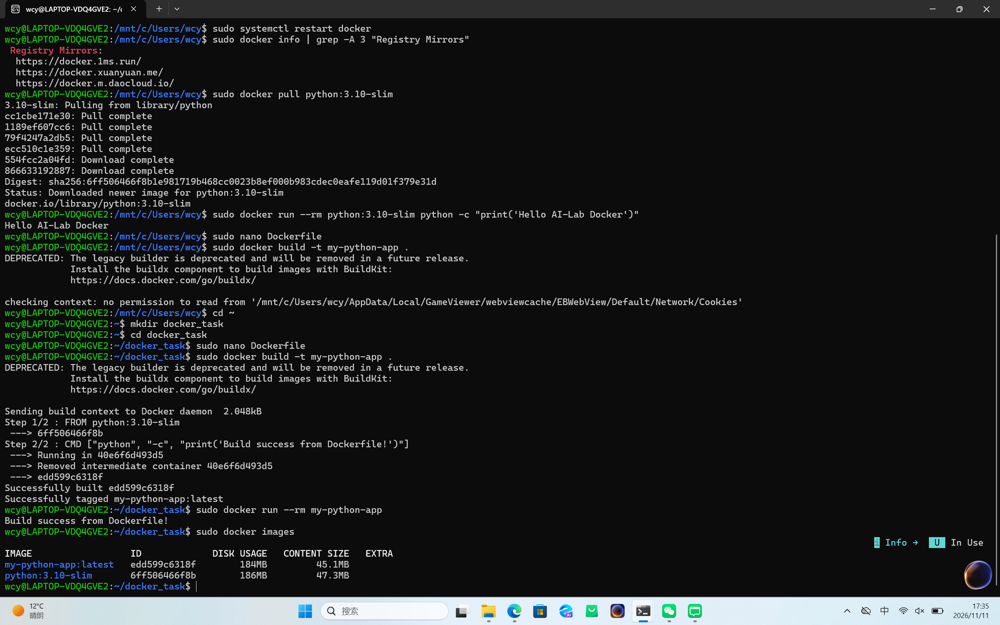

```markdown
Task 06: Docker 容器化技术初探

一、 镜像与容器的理解
镜像 (Image)：类似于装系统用的“光盘”或代码压缩包，是静态的、只读的模板。在本任务中对应 `python:3.10-slim` 和 `my-python-app`。
容器 (Container)：是镜像运行起来后的“实例”，相当于一个极其轻量级的独立环境。本任务通过 `docker run` 启动了容器。

二、 核心命令执行记录
在本地 WSL2 (Ubuntu) 环境中成功安装 Docker，并完成了以下操作：

```bash
1. 配置国内镜像源加速后，成功拉取镜像
sudo docker pull python:3.10-slim

2. 运行容器并输出测试文本
sudo docker run --rm python:3.10-slim python -c "print('Hello AI-Lab Docker')"

3. 编写 Dockerfile 并构建自定义镜像
sudo docker build -t my-python-app .

4. 运行自定义镜像
sudo docker run --rm my-python-app

5. 查看本地镜像列表
sudo docker images
```

三、 Dockerfile 源码

```dockerfile
FROM python:3.10-slim
CMD ["python", "-c", "print('Build success from Dockerfile!')"]
```

四、 终端运行日志截图





五，报错说明
1. Docker 守护进程连接被拒
   现象：permission denied while trying to connect...。
   原因：当前用户未加入 docker 组。
   解决：所有命令前加 sudo 提权。
2. 拉取镜像超时
   现象：dial tcp ... i/o timeout。
   原因：国内无法直连 Docker Hub。
   解决：在 /etc/docker/daemon.json 中配置国内镜像加速源。
3. Docker Build 找不到上下文或被拒绝
   现象：no permission to read from '/mnt/c/.../Cookies'。
   原因：在挂载的 Windows 盘目录下执行 build，碰到了系统隐藏无权限文件。
   解决：cd 切换到 Linux 原生目录下再执行构建。
