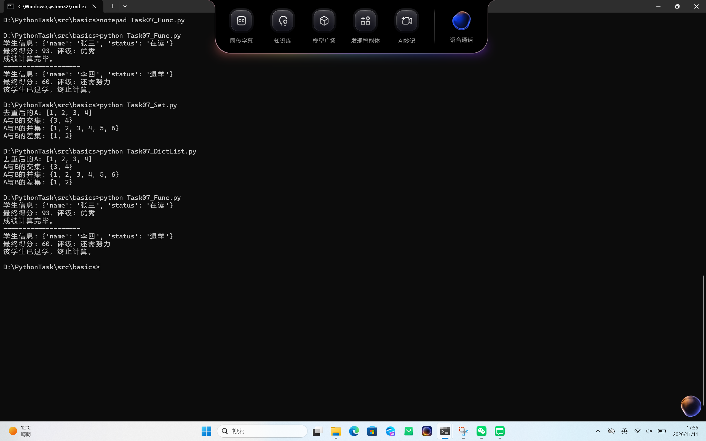
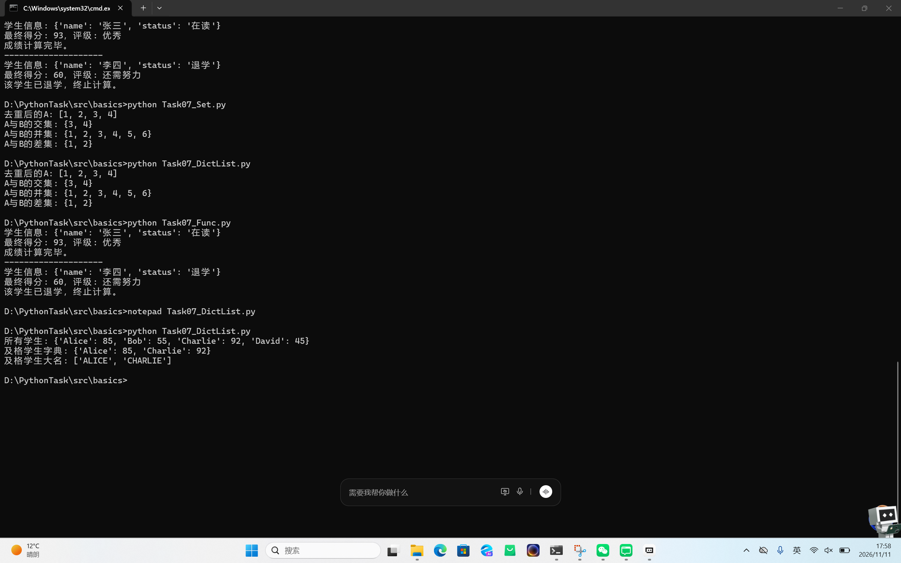

Task 07: Python 核心语法与常用数据结构

 一、 代码完成情况
已在本地成功编写并运行了 3 组核心练习代码，严格遵循 PEP8 规范：

1. Task07_Set.py：演示了集合的去重、交集、并集和差集运算。
2. Task07_DictList.py：演示了列表推导式、字典推导式以及 f-string 格式化输出。
3. Task07_Func.py：演示了函数参数的传递（默认参数、*args、**kwargs）以及条件判断和循环控制。

二、 运行结果截图

三，报错说明
1. 代码粘错位置
   现象：黑窗口报错 'def' 不是内部或外部命令。
   原因：把 Python 代码直接粘贴到了 CMD 命令行里，而不是在 .py 文件里运行。
   解决：用记事本建 .py 文件粘贴代码，在终端执行 python 文件名.py。
2. 代码文件内容混淆
   现象：运行字典的代码，打印出来的却是集合的结果。
   原因：保存文件时，记事本里的内容复制串了。
   解决：重新清空 .py 文件，粘贴正确代码。
