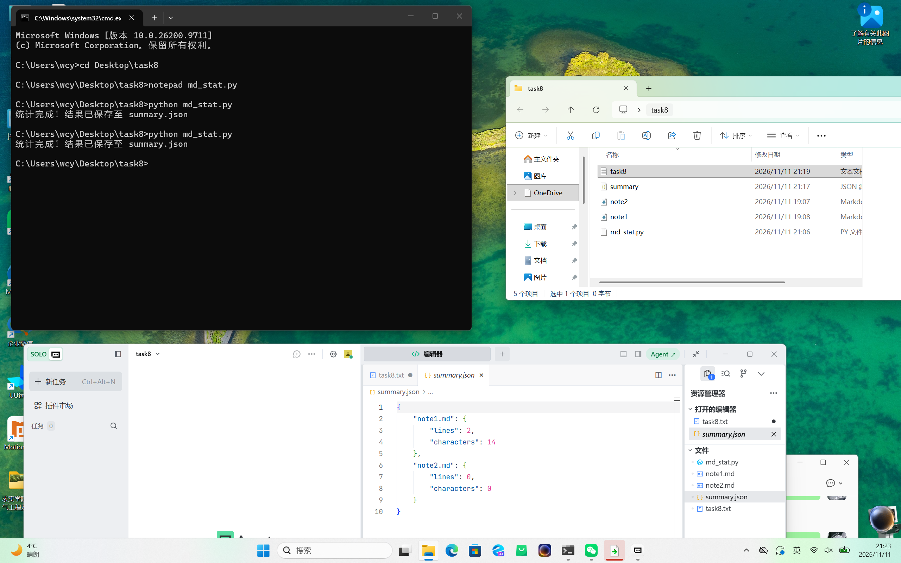

# Task 08: Python 文件 I/O、异常处理与工程基础
一、 实战任务说明
本次任务编写了一个 Python 自动化脚本 `md_stat.py`，用于扫描指定文件夹下的所有 `.md`（Markdown）文件，统计每个文件的行数与字数，并将最终结果结构化输出为 `summary.json` 文件。

二、 核心知识点应用
在脚本编写中，严格遵守了工程化基础要求：
1. 上下文管理器：使用 `with open(...)` 读写文件，确保文件句柄被正确关闭，并指定了 `encoding="utf-8"` 避免中文乱码。
2. 现代路径库：使用 `pathlib` 库的 `Path` 对象进行路径拼接、使用 `.exists()` 判断路径是否存在，以及使用 `.glob("*.md")` 高效遍历目标类型的文件。
3. 结构化数据序列化：使用 `json.dump()` 将 Python 字典转换为 JSON 格式写入文件，并加入了 `ensure_ascii=False` 和 `indent=4`，确保中文正常显示且格式美观。
4. 异常处理：使用 `try...except` 捕获文件读取和写入过程中可能发生的异常（如权限不足、文件损坏），保障程序的健壮性，避免崩溃。

三、 脚本源码 (`md_stat.py`)
```python
import json
from pathlib import Path

def scan_md_files(folder_path):
    target_dir = Path(folder_path)
    if not target_dir.exists() or not target_dir.is_dir():
        print(f"错误：文件夹 {folder_path} 不存在！")
        return

    summary_data = {}
    for md_file in target_dir.glob("*.md"):
        try:
            with open(md_file, "r", encoding="utf-8") as f:
                content = f.read()
                line_count = len(content.splitlines())
                word_count = len(content.strip())
                summary_data[md_file.name] = {
                    "lines": line_count,
                    "characters": word_count
                }
        except Exception as e:
            print(f"读取文件 {md_file.name} 时出错: {e}")
            
    output_file = target_dir / "summary.json"
    try:
        with open(output_file, "w", encoding="utf-8") as f:
            json.dump(summary_data, f, ensure_ascii=False, indent=4)
        print(f"统计完成！结果已保存至 {output_file.name}")
    except Exception as e:
        print(f"写入 JSON 文件失败: {e}")

if __name__ == "__main__":
    scan_md_files(".")
```
   
   


三，报错说明
1. 生成的 summary.json 为空
   现象：运行脚本没有报错，但打开 json 文件里面什么都没有。
   原因：目标文件夹里没有 .md 文件供脚本扫描，遍历结果为空。
   解决：手动在文件夹里新建几个测试用的 .md 文件，再重新运行脚本。
2. 在 Python 脚本中混入 Markdown 语句
   现象：代码末尾出现了 !
   原因：将写给组长看的文档说明，直接混入了 Python 源码。
   解决：将代码与文档分离，清理源码中的非 Python 语法。1. 生成的 summary.json 为空