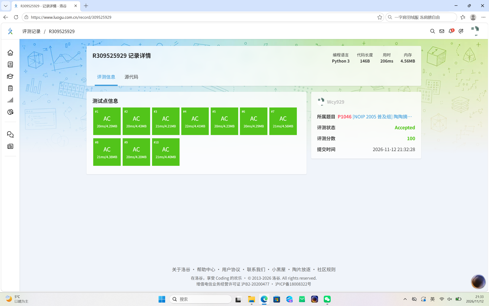
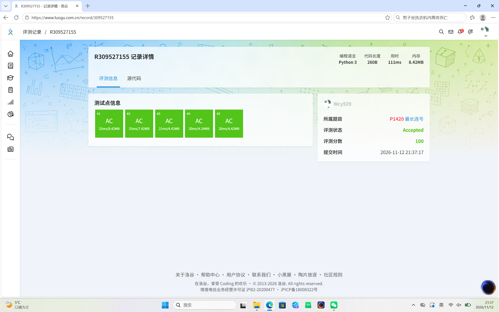
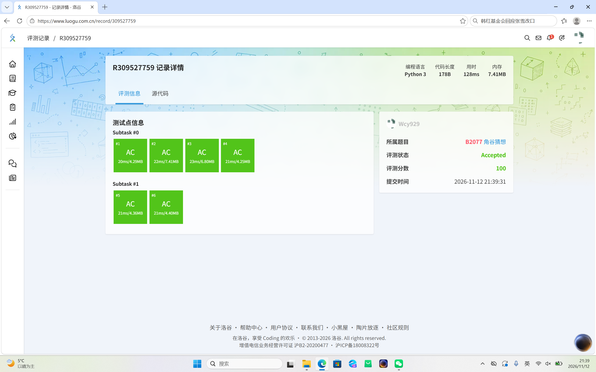
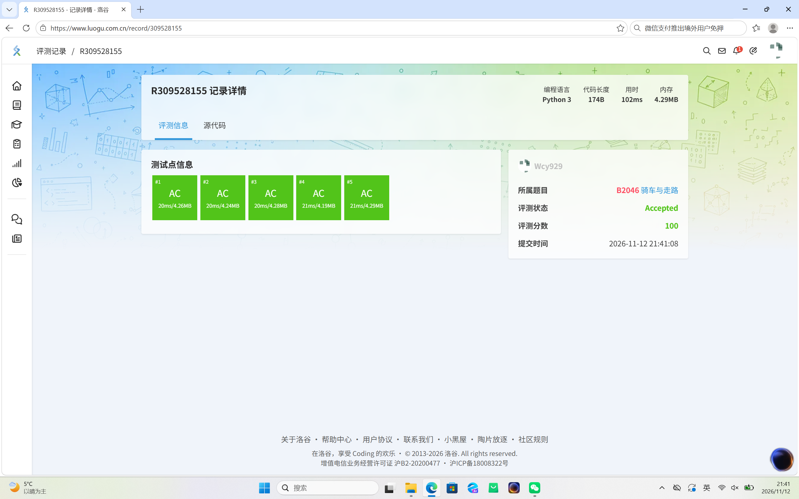
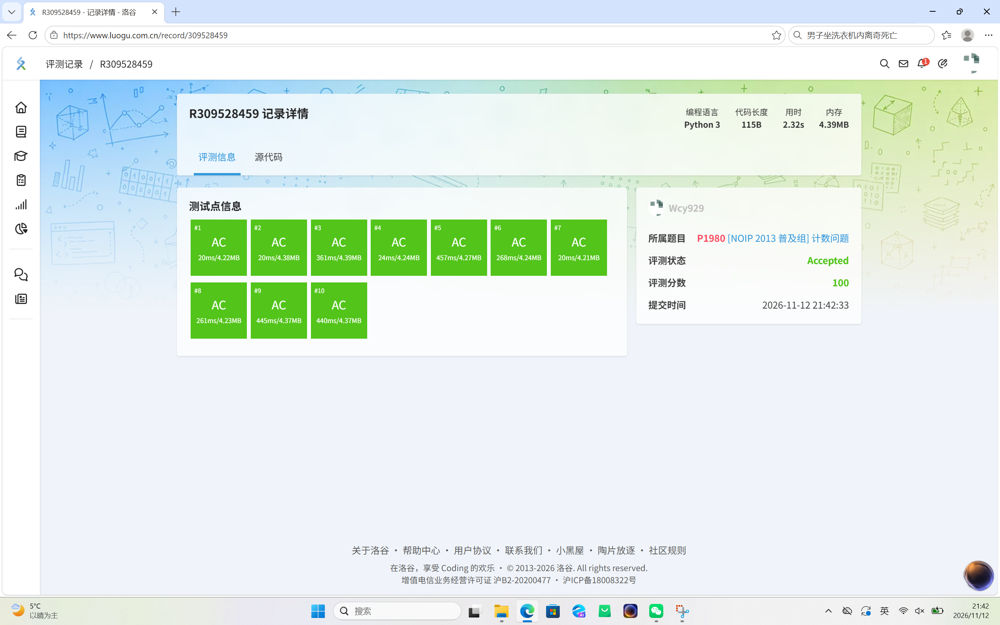
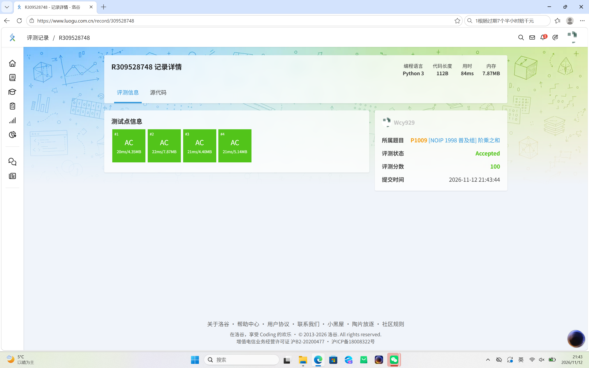

Task 09: 经典算法与编程逻辑专项巩固

一、 完成情况
本次任务完成了 6 道经典算法题，均使用 Python 3 编写，并在洛谷平台成功通过所有测试点（Accepted）。

包含题目：
1. P1046 陶陶摘苹果
2. P1420 最长连号
3. B2077 角谷猜想
4. B2046 骑车与走路
5. P1980 计数问题
6. P1009 阶乘之和

二、 提交记录截图

三、其他
由于课业要求是先学习c语言，所以没有充足的时间来了解python语言，暂时先将题目复制粘贴，然后会问豆包其原理，有时间会学习python语言。