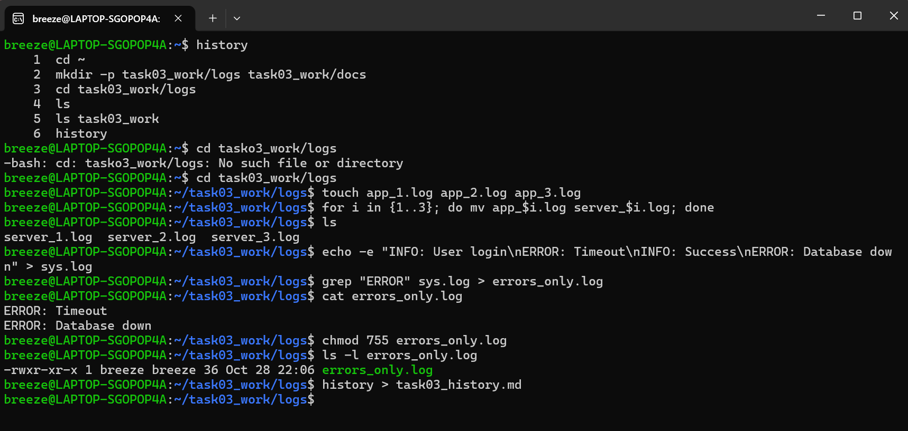

# history
``` bush
- cd 
- mkdir -p task03_work/logs task03_work/docs
- cd task03_work/logs
- ls
- ls task03_work
- history
- cd tasko3_work/logs
- cd task03_work/logs
- touch app_1.log app_2.log app_3.log
- for i in {1..3}; do mv app_$i.log server_$i.log; done
- ls
- echo -e "INFO: User login\nERROR: Timeout\nINFO: Success\nERROR: Database down" > sys.log
- grep "ERROR" sys.log > errors_only.log
- cat errors_only.log
- chmod 755 errors_only.log
- ls -l errors_only.log
- history > task03_history.md
```

# 截图

