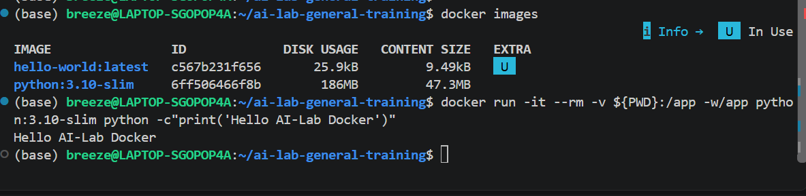
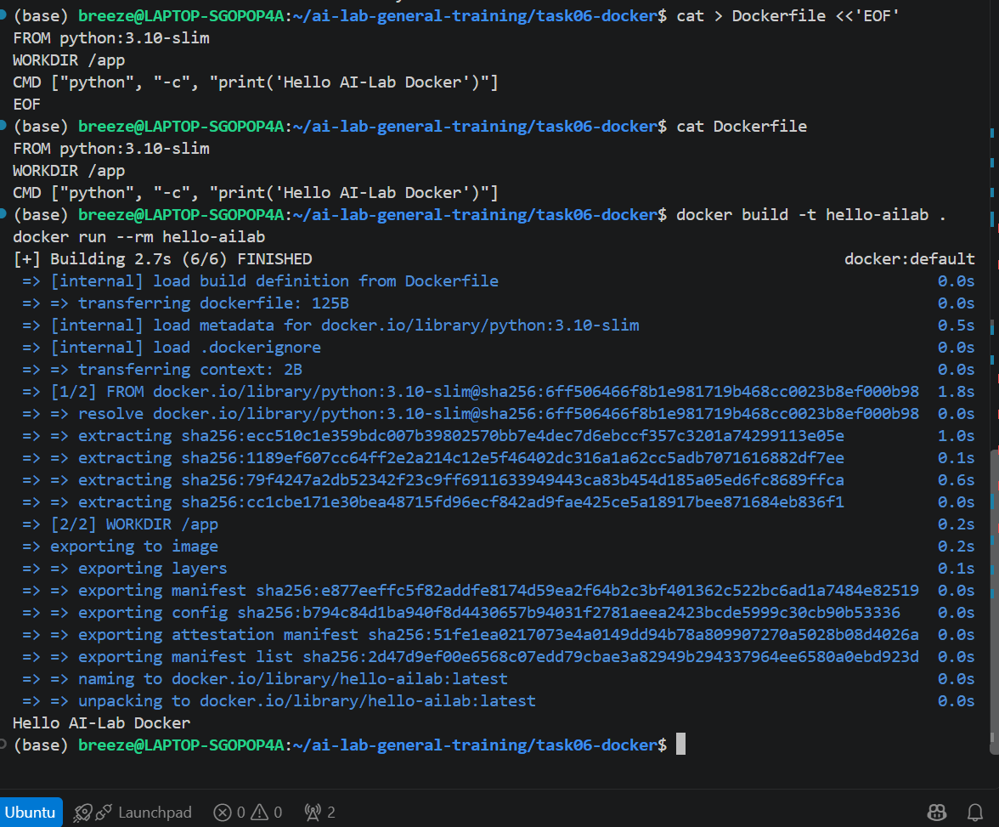
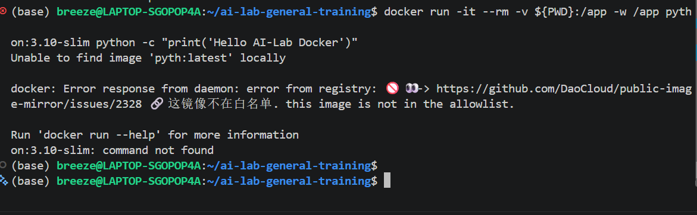
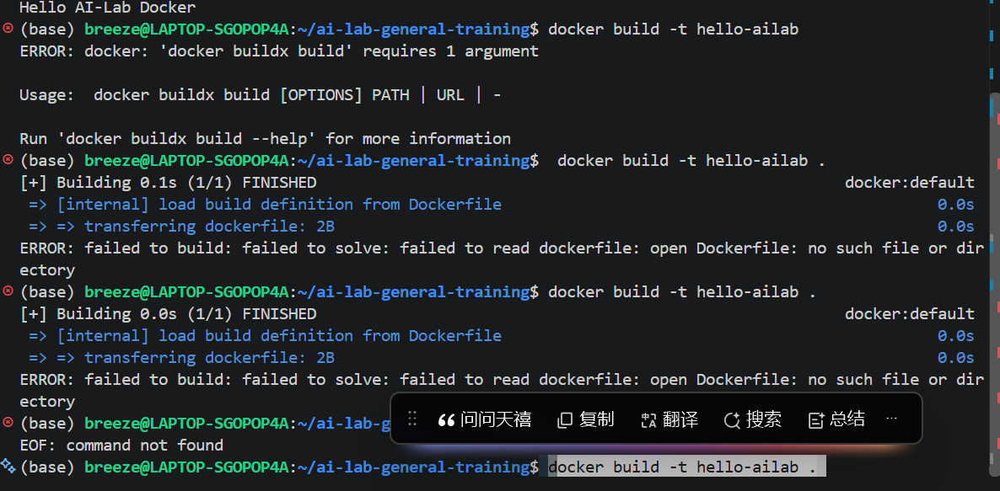

# 截图
- 
- 
# 报错
- 
  - 原因：命令输入时换行了
- 
  - 原因：Dockerfile没有成功创建
  - 重新创建：
  ```bash
  cat > Dockerfile <<'EOF'
  ROM python:3.10-slim
  WORKDIR /app
  CMD ["python", "-c", "print('Hello AI-Lab Docker')"]
  EOF
  ```